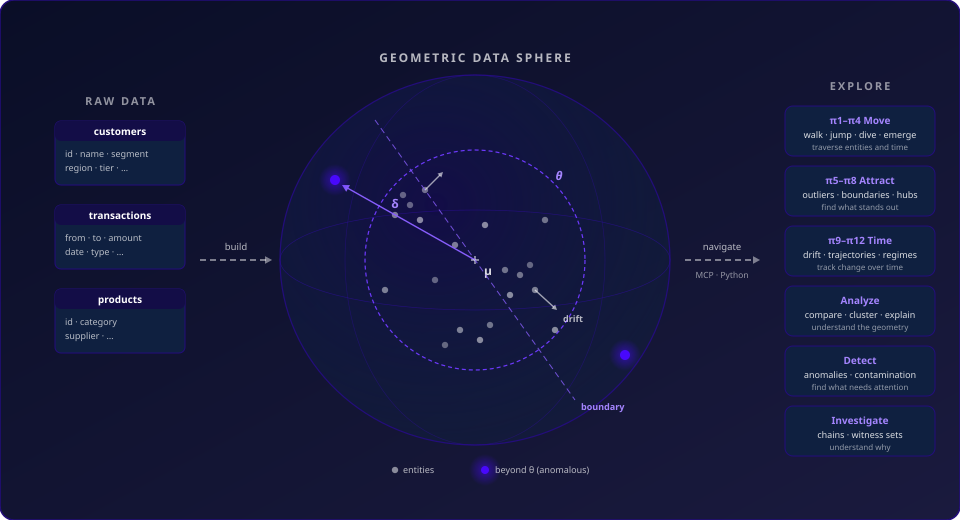
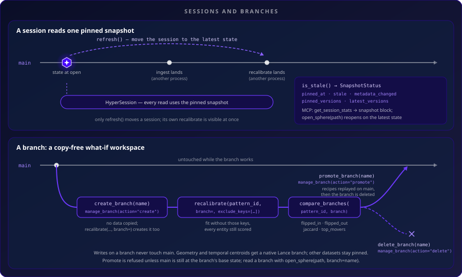

# hypertopos

> Business data as geometry that AI agents navigate — the core engine.

[](https://github.com/hypertopos/hypertopos-py/actions/workflows/test.yml)
[](https://www.python.org/downloads/)
[](LICENSE.md)
[](https://doi.org/10.5281/zenodo.19482069)
[](https://arrow.apache.org/docs/python/)
[](https://github.com/lance-format/lance)
[](https://modelcontextprotocol.io)
[](pyproject.toml)

Describe your tables in a YAML file, run `hypertopos build`, and every entity gets a position relative to its own population — so "out of place", "similar", "drifting" and "different between groups" become distances you read instead of queries you write.

- **No model, no labels.** The threshold θ is a percentile of the population's own distances; nothing is trained and nothing has to be annotated.
- **Explanations in the data's own columns.** `explain_anomaly` splits an anomaly into each dimension's share of the distance; the shares sum to 100%.
- **One snapshot per reader, what-if on a branch.** A session keeps its answers while data keeps arriving; a recalibration or trial ingest runs on a copy-free branch, gets compared with main, then is promoted or deleted.

<p align="center">
  
</p>
<p align="center"><sub><i>Distance from the centre is the real <code>delta_norm</code>; θ comes from the population.</i></sub></p>

hypertopos is not a database, and not a machine learning model. It is a layer that turns relational data into a coordinate system where every entity gets a position derived from its relationships and the population around it. It complements SQL: the database answers *which rows match*; hypertopos answers *which entities are out of place, how that is changing, and why*.

This package is the core engine of a three-package family:

| Package | Role |
|---|---|
| **hypertopos** (this package) | Builds the sphere from YAML, computes the geometry, serves snapshot sessions and copy-free branches to Python code and the CLI |
| [hypertopos-mcp](https://github.com/hypertopos/hypertopos-mcp) | The agent interface — an MCP server over the same core, over stdio or local HTTP, with responses shaped for an agent's context window |
| [hypertopos-skills](https://github.com/hypertopos/hypertopos-skills) | Investigation workflows that give an agent judgement about which tool to reach for, and when |

**Get started** (two minutes). Needs Python 3.12+ and two CSV files — one per entity type:

```bash
pip install hypertopos                                     # the engine and the `hypertopos` command
hypertopos validate --config sphere.yaml                   # check the YAML and every source file, nothing written
hypertopos build --config sphere.yaml --output my_sphere   # compute μ, σ, θ and every entity's position
hypertopos info my_sphere                                  # what got built
```

`sphere.yaml` names the sources, the entity lines and which column links an event to its anchor:

```yaml
version: "0.1.0"
sphere_id: my_sphere

sources:
  customers:
    path: customers.csv
  orders:
    path: orders.csv

lines:
  customers:
    source: customers
    key: customer_id
    role: anchor
  orders:
    source: orders
    key: order_id
    role: event

patterns:
  order_pattern:
    type: event
    entity_line: orders
    relations:
      - line: customers
        direction: in
        key_on_entity: customer_id
    event_dimensions:
      - column: amount
```

Then, from Python:

```python
from hypertopos import HyperSphere

hs = HyperSphere.open("my_sphere")
with hs.session("analyst") as session:
    nav = session.navigator()

    polygons, total, _, _ = nav.π5_attract_anomaly("order_pattern", top_n=5)
    print(f"{total} anomalous orders")
    for p in polygons:
        print(p.primary_key, round(p.delta_norm, 2))

    top = polygons[0].primary_key
    for d in nav.explain_anomaly(top, "order_pattern")["top_dimensions"]:
        print(d["dim"], f"{d['pct_of_total']:.0%}")
```

That's it. You get a sphere — the built, navigable geometry of one dataset, stored as Lance datasets under one directory:

```
my_sphere/
├── _gds_meta/
│   ├── sphere.json            # population statistics (μ, σ, θ) per pattern — read first on every open
│   ├── calibration/           # the current fit per pattern
│   ├── calibration_history/   # one epoch per build or recalibrate
│   └── branches/              # what-if branches, empty until you create one
├── points/customers/          # entity data per line (Lance)
├── points/orders/
└── geometry/order_pattern/    # delta vectors, delta_norm, edges per pattern (Lance)
```

> [!TIP]
> Run `validate` before every `build`. It parses the YAML and checks that every source file exists without writing anything; `build` fails late on the same problems after loading the data.

> [!NOTE]
> Paths under `sources:` resolve relative to the YAML file, not to your shell. On Windows, `python -m hypertopos.cli.main …` works wherever the `hypertopos` script is not on `PATH`.

## On Spark

Event tables that live in Spark (Databricks, a lakehouse, a cluster) need no YAML: one call goes from a DataFrame of events to a DataFrame of scored entities. The per-entity aggregation runs on the executors, and only one row per entity reaches the driver.

<p align="center">
  
</p>
<p align="center"><sub><i>Real output on synthetic data. A000335 lands outside its segment's θ ring; <code>explain</code> names the dimension that moved it.</i></sub></p>

```bash
pip install "hypertopos[spark]"        # on Databricks, plain `%pip install hypertopos`
```

```python
from hypertopos.datasets import synthetic_aml
from hypertopos.spark import explain, find_anomalies

data = synthetic_aml(n_accounts=1_000, seed=1)            # labelled synthetic payments, no download
tx = spark.createDataFrame(data.transactions.to_pandas())
accounts = spark.createDataFrame(data.accounts.to_pandas())
events = tx.join(accounts.select("account", "segment"), tx.from_account == accounts.account)

result = find_anomalies(events, entity="from_account", counterparty="to_account",
                        amount="amount", time="ts", group_by="segment")
result.orderBy("delta_norm", ascending=False).show(3)
explain(result, entities=["A000335"]).show(2)
```

Real output (local Spark, two cores):

```
+-------+----------+----------+-------+--------+------------------------------------------+
| entity|delta_norm|is_anomaly|p_value| segment|                               top_reasons|
+-------+----------+----------+-------+--------+------------------------------------------+
|A000335|    10.616|      true|  0.001|  retail|[{burst_max_daily, 5.31, 25.0}, ...       |
|A000259|    10.215|      true|  0.002|  retail|[{n_out, 5.62, 30.3}, ...                 |
|A000179|    10.208|      true|  0.003|business|[{active_days, -4.80, 22.1}, ...          |
+-------+----------+----------+-------+--------+------------------------------------------+

+-------+---------------+-----+-----+-----+-----+------------+---------+
|entity |dim            |value|mu   |sigma|delta|pct_of_total|direction|
+-------+---------------+-----+-----+-----+-----+------------+---------+
|A000335|burst_max_daily|20.0 |7.683|2.320|5.31 |25.0        |above    |
|A000335|amount_std_out |7.583|3.771|0.779|4.89 |21.2        |above    |
+-------+---------------+-----+-----+-----+-----+------------+---------+
```

`A000335` made 20 payments on its busiest day, against about 8 for retail accounts (+5.3 σ), and its payment amounts vary far more than theirs (`amount_std_out` is log-scaled). In the labels of `data.accounts` it is one of the planted fan-out accounts. The other two are not laundering, only unusual, which is what a distance from the population measures: `p_value` 0.001 means one entity in a thousand is as far out. The labels let you measure how a detector does on the same data. `explain` shows where every number comes from. `score(new_events, like=result)` scores the next batch against this calibration on the executors, and `sphere_of(result)` hands the same geometry to an agent through the MCP server.
> [!TIP]
> On a laptop, create the session with `.master("local[2]").config("spark.sql.shuffle.partitions", "4")`. The default of 200 shuffle partitions is sized for a cluster.

Everything else, from column roles and the 23 dimensions to time handling, the cache and the CLI, is in [hypertopos on Spark](docs/spark.md).

## See it in action

Real output from the YAML above on a 40-customer, 313-order CSV pair (three orders carry amounts an order of magnitude above the rest):

```text
$ hypertopos validate --config sphere.yaml
Valid: my_sphere (2 sources, 2 lines, 1 patterns, 0 composite lines, 0 temporal configs)

$ hypertopos build --config sphere.yaml --output my_sphere
Built: my_sphere

$ hypertopos info my_sphere
Sphere: my_sphere
Path:   …/my_sphere

Lines (2):
  customers                       role=anchor    rows=40  cols=3
  orders                          role=event     rows=313  cols=4

Patterns (1):
  order_pattern                   type=event     entity=orders  dims=2

Total disk size: 104.3 KB
```

The Python snippet above, on that sphere:

```text
16 anomalous orders
ORD-0311 8.46
ORD-0312 8.46
ORD-0313 8.46
ORD-0053 1.75
ORD-0020 1.71
amount 100%
```

`delta_norm` is the order's distance from the population centre, measured in σ; the three planted orders sit at 8.46 while the next one is at 1.75. `explain_anomaly` attributes the whole distance to `amount` — the only event dimension in this sphere — as a share of `delta_norm²`.

<p align="center">
  
</p>
<p align="center"><sub><i>With a temporal configuration, every entity also keeps a history of positions; each slice's distance is its real <code>delta_norm_snapshot</code>.</i></sub></p>

## How it works



**Build.** `hypertopos build` reads the sources named in the YAML, computes the population statistics every coordinate is measured against (μ, σ and the threshold θ per dimension — the calibration), and writes the sphere: points, delta vectors, edges and temporal history as Lance datasets. Later batches are ingested into the same sphere with `hypertopos sphere ingest` or `GDSBuilder.incremental_update`, without a full rebuild.

**Navigate.** A session opens on the sphere and moves through it with twelve navigation primitives (π1–π12): walking along a line of entities, jumping across a relationship, diving into an entity's history, and the attractors — π5 `attract_anomaly`, boundary, hub, cluster, drift, trajectory, population comparison and regime change. Each step is stateful: where you are determines what you see next. Opening a sphere reads a few kilobytes of metadata; everything else is loaded as navigation requires it.

**Stay consistent.** A session reads one consistent snapshot of the sphere — the state current when it opened. Ingests and recalibrations by other processes do not change its answers mid-investigation. A session sees its own `recalibrate` immediately, and every recalibration records a calibration epoch exactly as a rebuild does, so `compare_calibrations` can show what moved between any two fits.

> [!IMPORTANT]
> A session does not see new data until you ask for it. `session.is_stale()` returns a `SnapshotStatus` whose `stale` flag says a newer state exists; `session.refresh()` moves the session to it. Nothing refreshes on its own.

**Try things on a branch.** A sphere branch is a what-if workspace created without copying data; writes on a branch never touch main.



*Sessions never change under you; branches never touch main.*

Continuing inside the `with` block of the snippet above — recalibrate on a branch without the top anomaly in the baseline, compare, then keep or drop the result:

```python
    result = session.recalibrate("order_pattern", branch="trial", exclude_keys=[top])
    print(result["n_excluded"], result["old_theta_norm"], result["new_theta_norm"])

    diff = nav.compare_branches("order_pattern", "trial")
    print(diff.flipped_in, diff.flipped_out, round(diff.jaccard, 2))

print(hs.promote_branch("trial"))   # replay the branch's recalibrations and ingests on main, then delete it
# hs.delete_branch("trial")         # or discard it; main is unchanged
```

Real output on the sphere above:

```text
1 1.2203 1.3675
1 0 0.94
PromoteReport(name='trial', recipes_replayed=1, versions_before={'order_pattern': 7}, versions_after={'order_pattern': 10})
```

One entity was excluded from the fit, θ moved from 1.22 to 1.37, one order became anomalous on the branch (`flipped_in`), none stopped being anomalous, and the two anomaly sets overlap at 0.94 Jaccard. `exclude_keys` fits the population statistics without those entities while still scoring every entity. Promoting replays the branch's recipes on main and verifies that the replayed fit matches.

> [!TIP]
> Always pass `branch=` together with `exclude_keys`. Without it the recalibration lands on main, and the only way back is another recalibration.

> [!WARNING]
> `promote_branch` is refused when main has moved since the branch was created — compare, then recreate the branch from the current main. `delete_branch` and `promote_branch` are also refused while an open session reads the branch; close those sessions first.

The same workflow is available from the CLI (`hypertopos sphere branch`, `hypertopos sphere ingest --branch`) and to agents through the [MCP server](https://github.com/hypertopos/hypertopos-mcp).

For the full picture: [Introduction](docs/introduction.md) · [Core Concepts](docs/concepts.md) · [Architecture](docs/architecture.md)

## Common commands

```bash
hypertopos validate --config sphere.yaml                        # parse the YAML, check every source file; writes nothing
hypertopos build --config sphere.yaml --output my_sphere        # full build; --force overwrites an existing directory
hypertopos build --config sphere.yaml --output my_sphere \
    --no-temporal --no-chains --no-edges                        # skip stages for a fast iteration build
hypertopos info my_sphere                                       # lines, patterns, disk size

hypertopos sphere health my_sphere --exit-code-on-critical      # CI gate: ok / warning / critical, exit 2 on a HIGH alert
hypertopos sphere validate my_sphere --strict                   # structural check; --strict turns calibration warnings into errors
hypertopos sphere diff old_sphere my_sphere --json              # pattern inventory and calibration drift between two builds

hypertopos sphere ingest my_sphere --points new_orders.csv --pattern order_pattern            # append new or changed entities, no rebuild
hypertopos sphere ingest my_sphere --points new_orders.csv --pattern order_pattern --branch trial   # same, on a branch only
hypertopos sphere ingest my_sphere --points new_orders.csv --pattern order_pattern --finalize       # last batch: global ranks + index rebuild

hypertopos sphere branch list my_sphere                         # what exists, with recipe counts and staleness
hypertopos sphere branch create my_sphere trial --purpose "recalibrate without top anomaly"
hypertopos sphere branch promote my_sphere trial                # replay the branch's recipes on main, then delete it
hypertopos sphere branch delete my_sphere trial                 # discard it; main is unchanged

hypertopos spark find-anomalies --input tx.parquet --entity from_account \
    --counterparty to_account --amount amount --time ts --show 20   # events on Spark -> scored entities (hypertopos[spark])
```

Every `hypertopos sphere …` subcommand takes `--json` for machine-readable output. See the [full command reference](#full-command-reference) below.

> [!NOTE]
> An `edges/` adjacency table is only written for event patterns with two or more relations to the same anchor line (sender and receiver accounts, for example). It powers graph traversal — paths, flows, contagion — and `--no-edges` skips it.

## Troubleshooting

| Symptom | Fix |
|---|---|
| `error: output directory 'my_sphere' already exists. Use --force to overwrite.` | Add `--force`, or build into a new directory. |
| `error: output directory '…' has branches ['trial']; delete them first (--force does not delete branches).` | `hypertopos sphere branch delete` (or `promote`) every branch, then build. |
| Creating a branch on Windows fails with a message about the 260-character path limit | Branch files live under `<dataset>/tree/<branch>/`, which can push paths past Windows' limit. Move the sphere to a shorter directory, use a shorter branch name, or enable long paths in Windows (`LongPathsEnabled`). |
| `Validation errors:` / `Source 'orders': file not found: …` | Source paths resolve relative to the YAML file's directory, not the shell's. |
| `error: not a sphere directory (no _gds_meta/sphere.json): …` | Point `info` and `sphere …` at the directory that contains `_gds_meta/sphere.json`. |
| `sphere validate` prints `dim_quality warning (non_normal_dim) on dim 'amount'` | Advisory: a gaussian-declared dimension with a heavy tail. Declare a `kind` or transform the column; `--strict` turns it into a failure for CI. |
| `sphere validate` prints `dim_quality warning (dominant_dim_mass)` | One dimension carries most of the tail variance — the pattern is effectively a one-dimension detector. Add independent dimensions or split the column. |
| A session keeps returning the same answers after an ingest | Sessions are pinned to a snapshot. `session.is_stale()`, then `session.refresh()`. |
| `promote_branch` refused: main moved since the branch was created | `compare_branches` to see what differs, then delete the branch and create it again from the current main. |
| `delete_branch` / `promote_branch` refused: a session reads the branch | Close every session opened with `branch=` first. |
| Lance warns `KMeans: more than 10% of clusters are empty` during build | The dataset is too small for a meaningful vector index; the warning is informational and the build is complete. |

## What's different

Every capability below comes from one decision: an entity is a point in a space calibrated on its own population. The same coordinate answers anomaly, similarity, drift and group questions, so the answers stay comparable and explainable in the data's own dimensions.

### A coordinate system that calibrates itself

| Capability | What it does | Instead of |
|---|---|---|
| Population-relative coordinates | `delta = (shape − μ) / σ` per dimension; one vector serves anomaly, clustering, drift and comparison | Learned embeddings with latent dimensions that need retraining when the data shifts |
| Self-calibrating threshold | θ is a percentile of the population's own `delta_norm` — per group when a pattern declares `group_by_property` | Choosing a contamination rate or a hand-tuned cut-off |
| Distribution-aware dimensions | Each dimension declares a kind (gaussian, poisson, bernoulli), detected or set with `kind:` on precomputed dimensions; `sphere_overview` flags dead, sparse, non-normal and dominant dimensions with concrete advice | One metric for every feature, and silent garbage when a feature breaks its assumption |
| Calibration epochs | Every build and `recalibrate` records an epoch; `compare_calibrations` shows per-dimension μ / σ / θ drift, `theta_sensitivity` shows whether θ sits near a cliff | No record of how the coordinate system itself moved |
| Hidden influencers | `find_calibration_influencers` measures each entity's leave-one-out impact on the calibration and names the ones that distort it | Explaining predictions while the baseline itself is contaminated |

### Explanations and confidence

| Capability | What it does | Instead of |
|---|---|---|
| Named attribution | `explain_anomaly` ranks real dimensions by their share of `delta_norm²`; shares sum to 100% | SHAP / LIME approximations over a trained model |
| Alternative hypotheses | `find_diverse_explanations` returns disjoint dimension sets that each explain the anomaly | One explanation and a manual search for "what else could it be" |
| Error-controlled detection | Benjamini-Hochberg or Storey FDR on χ² p-values, per entity or per dimension; bootstrap `anomaly_confidence` with a `min_confidence` filter | A ranked list with no statement about false discoveries or stability |
| Verdicts an agent can act on | `assess_anomaly_certainty`, `consensus_classification`, `calibration_drift_report`, `theta_sensitivity_report` return a verdict with its rationale | Stitching several low-level calls and interpreting them by hand |
| Anomaly by absence | `find_density_gaps` finds combinations that are missing from the population; `find_conformance_violations` checks declared rules | Outlier detection, which only sees extremes that exist |

### Time

| Capability | What it does | Instead of |
|---|---|---|
| Entity trajectories | Each entity keeps a history of its position; `find_drifting_entities` ranks displacement and says whether it moves toward or away from normal | Metric time series with no notion of position or direction |
| Drift you can attribute | `decompose_drift` splits drift into the entity's own movement and the population's recalibration | Drift magnitude, where a moving baseline and a changing entity look the same |
| Population shifts | `find_regime_changes` and `compare_time_windows` detect when the population itself changed; `find_lead_lag` finds which pattern moves first | Model-prediction drift monitors |

### Graphs, chains and motifs

| Capability | What it does | Instead of |
|---|---|---|
| Graph structure as geometry | PageRank, betweenness, community and clustering become dimensions; `edge_dim_aggregations` bake per-edge signals into each entity's position | A separate graph database joined by hand |
| Propagation with a control group | `contagion_score` and `propagate_influence` compare connected neighbourhoods against a control; `find_witness_cohort` finds similar but unconnected entities that confirm a pattern | PageRank-style topology with no behavioural baseline |
| One-call root cause | `trace_root_cause` returns a bounded evidence graph: witnesses, counterparties, contamination, hubs | Four or more manual calls |
| Scored edges and motifs | `score_edge` scores one relationship; `find_high_potential_motifs` scores fan-out, fan-in, cycles, structuring, split-recombine and bipartite bursts; `find_motif_by_hops` takes any hop sequence | Subgraph queries that match shapes but cannot rank them by rarity |
| Chain investigation | `find_chains_with_coherent_anomaly` finds chains whose consecutive members are anomalous in the same way; `investigate_chain` and `chain_full_loop_summary` return a verdict with its evidence; `generate_sar_rationale` drafts the narrative. Chains found by other systems load as anchor lines | Per-chain SQL and a blank page for the report |

### What-if

| Capability | What it does | Instead of |
|---|---|---|
| Counterfactuals | `simulate_edge_removal` and `simulate_dimension_change` recompute an entity against the fixed calibration with an edge removed or a value overridden | An explicit causal model, or rebuilding to find out |
| Branches | A copy-free branch takes a recalibration without suspected influencers (`exclude_keys`) or a trial ingest; `compare_branches` lists who flips in or out of anomaly; promote replays the change onto main, delete discards it | Copying the sphere, rerunning, and diffing by hand |

### Running it

| Capability | What it does | Instead of |
|---|---|---|
| Snapshot sessions | Every session reads one consistent snapshot while builds, ingests and recalibrations land; `is_stale()` and `refresh()` move it on | Pausing ingestion, or two reads of the same question that disagree |
| Incremental ingest | `incremental_update` adds, changes and removes entities without a full rebuild | Rebuilding from source for every batch |
| Operations CLI | `hypertopos sphere health`, `validate` and `diff` give CI gates and drift between two builds; vector-index health is reported before trajectory tools rely on it | Hand-rolled validation scripts |
| An agent surface | The MCP server runs over stdio or HTTP with a session per agent and compact, strict-JSON responses sized for a context window | Wrapping a database in ad-hoc tools |
| On Spark | `hypertopos.spark.find_anomalies(df, entity=…, …)` aggregates events per entity on the executors and returns a DataFrame with distance, flag, p-value and reasons; `explain` breaks it down, `sphere_of` hands it to an agent. Runs on classic clusters and Spark Connect, including Databricks serverless | Exporting events, building features by hand and running a detector outside the cluster |
| Frozen scoring | `FrozenCalibration` (and `hypertopos.spark.score` on executors) scores new data against a fixed population without recalibrating | Refitting the detector on every batch, so yesterday's and today's scores are not comparable |
| Data to try it on | `hypertopos.datasets.synthetic_aml` generates a labelled payments dataset with six laundering patterns | Hunting for a public dataset before the first call |

### What changes in practice

| Problem | Typical approach | With hypertopos |
|---|---|---|
| Find what is unusual | Engineer features, train a model, pick a contamination rate, retrain on shift | Build from YAML, call `find_anomalies` — θ comes from the population |
| Say why it is unusual | Feature importance from a model you have to trust | `explain_anomaly` — real dimensions, shares that sum to 100%; `find_diverse_explanations` for alternatives |
| Know it is not a fluke | Rerun with other thresholds, ask a domain expert | `find_witness_cohort` for unconnected look-alikes, `min_confidence` for stability, FDR for the whole list |
| Find the cause | Explain, then counterparties, then contagion, then hubs | `trace_root_cause` in one call |
| Catch layering and typologies | Rule engines and rare-pair SQL | `score_edge`, `find_high_potential_motifs`, `find_motif_by_hops`, and chain investigation with a verdict |
| See behaviour change | Export to a time-series database and set manual alerts | `find_drifting_entities` with direction; `decompose_drift` to separate entity from baseline |
| Compare across datasets | Align schemas and units | Compare `delta_norm` directly — it is measured in σ in every sphere |
| Change the baseline safely | Copy production, rerun, diff by hand | `recalibrate(..., branch="trial", exclude_keys=[...])`, `compare_branches`, then promote or delete |
| Read while data arrives | Pause ingestion or accept inconsistent reads | Snapshot sessions with `is_stale()` / `refresh()` |

## Benchmarks

Validated on three domains with the same engine, zero domain rules, zero labels:

| Domain | Dataset | Key result |
|--------|---------|------------|
| Banking | Berka (Czech, real data) | 85.5% recall on loan defaults |
| AML | IBM AML (synthetic) | 80.4% recall, zero labels |
| Transport | NYC Yellow Taxi (7.6M trips) | 8/8 anomaly categories detected |

Benchmark scripts and data preparation are included. Results are reproducible. Numbers are from the pre-0.1.0 validation run and have not been re-evaluated against recent releases.

Full results: [Benchmarks](docs/benchmarks.md)

## Full command reference

<details>
<summary><b>CLI</b> (click to expand)</summary>

| Command | What it does |
|---|---|
| `hypertopos validate --config FILE` | Parse the YAML and check every source file without building |
| `hypertopos build --config FILE [--output DIR] [--force] [--verbose] [--no-temporal] [--no-chains] [--no-edges] [--label-aware-calibration]` | Build the sphere. `--output` overrides the YAML's output directory; `--force` overwrites an existing one (never one that has branches); the `--no-*` flags skip stages; `--label-aware-calibration` is a no-op unless the YAML declares a `label_audit` block |
| `hypertopos info DIR` | Lines, patterns and disk size of a built sphere |
| `hypertopos sphere health DIR [--json] [--exit-code-on-critical]` | Health status `ok` / `warning` / `critical` with alert counts; exit 2 on critical when asked |
| `hypertopos sphere validate DIR [--strict] [--json]` | Structural integrity check; `--strict` promotes calibration and dimension-quality warnings to errors |
| `hypertopos sphere diff OLD NEW [--json]` | Pattern inventory and calibration drift between two built spheres |
| `hypertopos sphere ingest DIR --points FILE [--pattern ID] [--recalibrate auto\|force\|never] [--reindex] [--finalize] [--branch NAME] [--json]` | Append a table of new or changed entities (`.arrow`, `.parquet`, `.csv`, `.csv.gz` with a `primary_key` column) to a pattern; `--pattern` is optional when the sphere has exactly one |
| `hypertopos sphere branch {list,create,delete,promote} DIR [NAME] [--purpose TEXT] [--json]` | Manage sphere branches |

</details>

<details>
<summary><b>Python API map</b> (click to expand)</summary>

| Object | Entry points |
|---|---|
| `HyperSphere` | `open(path, branch=None)`, `session(agent_id, branch=None)`, `create_branch(name, purpose=…)`, `branches()`, `delete_branch(name)`, `promote_branch(name)` → `PromoteReport` |
| `HyperSession` | `navigator()`, `sphere()`, `is_stale()` → `SnapshotStatus`, `refresh()`, `recalibrate(pattern_id, branch=…, exclude_keys=…)`, `close()`; usable as a context manager |
| `GDSNavigator` | The twelve primitives (`π1_walk_line` … `π12_attract_regime_change`), `explain_anomaly(primary_key, pattern_id)`, `compare_branches(pattern_id, branch, other=None, top_n=20)` → `BranchDiffReport`, and the analysis, chain, motif and calibration methods listed in the [API Reference](docs/api-reference.md) |
| `GDSBuilder` | Programmatic build and `incremental_update` — the engine behind `hypertopos build` and `hypertopos sphere ingest` |

</details>

See [Configuration](docs/configuration.md) for the YAML reference and [Container Deployment](docs/container-deployment.md) for running these as one-shot jobs.

## Documentation

| | |
|---|---|
| [Introduction](docs/introduction.md) | The idea and where it stands |
| [Quick Start](docs/quickstart.md) | Install, build, navigate from Python, try a branch, connect an agent |
| [Core Concepts](docs/concepts.md) | Mathematical foundation, objects, calibration epochs, snapshots and branches |
| [Architecture](docs/architecture.md) | Package layers, snapshot sessions, sphere branches, the MCP layer |
| [Configuration](docs/configuration.md) | Sphere builder YAML reference |
| [API Reference](docs/api-reference.md) | Python API |
| [Data Format](docs/data-format.md) | On-disk storage format, including branches |
| [External Chains as Anchor Lines](docs/external-chains-as-anchor-line.md) | Ingest chains found by other systems and investigate them with the same primitives |
| [Container Deployment](docs/container-deployment.md) | Run the CLI as one-shot container jobs |
| [hypertopos on Spark](docs/spark.md) | From a Spark DataFrame of events to per-entity geometry |
| [Benchmarks](docs/benchmarks.md) | Validation results — banking, AML, transportation |

## Status

Research-stage project. Working code, reproducible benchmarks, active development. API may change.

## License

[Business Source License 1.1](LICENSE.md). Free for internal use, development, testing, and research. See LICENSE.md for details.
