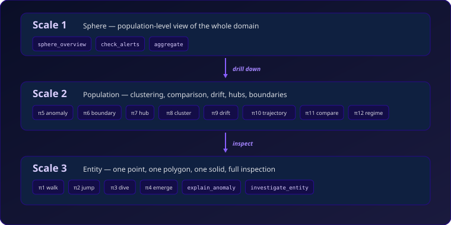
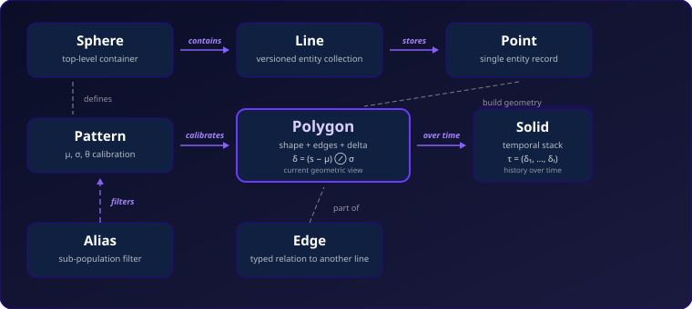

# Core Concepts

> Mental model, vocabulary, and object relationships for the Geometric Data Sphere.

## GDS in One Sentence

Geometric Data Sphere (GDS) represents business data as a population-relative geometric space that agents can navigate step by step.

## The Main Idea

The system models a domain as a sphere:

- entities belong to lines
- each entity has a polygon
- populations define patterns
- time turns polygons into solids
- agents explore the result with navigation primitives instead of only queries

The main shift is from "what rows match this filter?" to:

- how does this entity differ from its population?
- how does that difference change over time?
- which entities are structurally close, drifting, anomalous, or boundary-near?

That makes GDS useful when the interesting part of the problem is not a single record, but the shape of the population around it.

## Mathematical Foundation

GDS operates in a **delta space** (ℝ^D, d₂) — a complete metric space where each entity's position is derived from its relationship structure.

**Shape vector.** For entity *e* with *D* typed relation dimensions:

```
s(e) ∈ [0,1]^D     (normalized edge counts per relation type)
```

**Delta vector.** Population-relative z-score position:

```
δ(e) = (s(e) − μ) ⊘ σ
```

where μ = E[s] is the population mean, σ = max(std(s), ε) the clamped standard deviation. The delta vector is the core coordinate — it tells you where an entity sits relative to its population norm, dimension by dimension. Its length, `delta_norm` = ‖δ‖₂, is the entity's distance from the population centre. μ, σ and the threshold θ together are the pattern's **calibration** (see [Calibration epochs](#calibration-epochs)).

**What the delta space enables:**

- **Clustering** — entities with similar δ occupy the same region; k-means++ discovers natural geometric archetypes
- **Similarity search** — ANN over δ finds structurally similar entities regardless of surface-level attributes
- **Population comparison** — contrasting δ distributions between groups reveals which dimensions discriminate them (Cohen's d)
- **Hub analysis** — structural centrality scores from normalized connectivity in the shape vector
- **Segment partitioning** — cutting planes (w·δ ≥ b) partition the population into named segments with derived statistics
- **Anomaly detection** — every continuous anchor pattern carries a calibrated evidence score with an alarm budget: at the 95th percentile at most 5 % of the population is flagged; entities scored later keep that budget against the stored reference (see [Calibrated anomaly score](#calibrated-anomaly-score)); other patterns flag entities with ‖δ‖₂ > θ (empirical quantile threshold) — no training, no labels
- **Dimension ranking** — each dimension's share of `delta_norm²` identifies which relations drive an entity's position (witness sets)
- **Drift tracking** — temporal sequences τ(e) = (δ₁, ..., δₜ) measure how an entity's geometric position evolves
- **Trajectory forecasting** — extrapolation of temporal coordinate sequences predicts future position, anomaly status, and segment crossings
- **Population-level temporal analysis** — centroid displacement across time windows detects structural regime shifts
- **Stateful navigation** — typed position state (Point → Polygon → Solid) with AI agent tool-callable primitives
- **Cross-sphere comparison** — `delta_norm` is dimensionless, so scalar metrics from independently calibrated coordinate spaces compare across separate data systems
- **What-if analysis** — hypothetical edge or dimension changes (`simulate_edge_removal`, `simulate_dimension_change`) recompute an entity's position against the fixed calibration; a recalibration or ingest tried on a [sphere branch](#sessions-snapshots-and-branches) shows its effect on the whole population before it touches main

## Calibrated anomaly score

The shape layer above (δ, `delta_norm`, μ, σ, θ) says *where* an entity sits, per named dimension. The anomaly decision of a continuous anchor pattern whose dimensions are point properties comes from a second, separate layer — the **calibrated evidence score**. A pattern on this score lists the dimensions it scores in `score_dims` (identifier-like dimensions such as component or community ids are left out) and the axes it fits in `score_axes`.

**Axes.** Each axis turns the entity into one number, and the score combines their population ranks:

- `mahal` — Ledoit–Wolf (shrunk-covariance) Mahalanobis distance on rank-Gaussian coordinates of `score_dims`: every dimension is mapped through its population CDF to a standard normal value, so heavy tails and mixed units do not dominate, and correlated dimensions are not counted twice. Always present.
- `current` — the entity's motion against the current: from its events in the two calendar halves of the event period, its state change is compared with the change of its nearest neighbours (the population's velocity field); the residual is what the entity does that its peers do not. Requested by default; `current` is fitted when exactly one event pattern references the pattern's entity line and carries an edge table (from / to keys, timestamp, amount) whose events span more than one moment; otherwise the pattern scores without it.
- `knn` — distance to the nearest peers in a compressed coordinate space. Opt-in (`score_axes: [mahal, current, knn]` in the pattern YAML).

`anomaly_score` is the mean of the axis ranks (each axis rank in `axis_ranks`), and `score_rank_pct` is the rank of `anomaly_score` in the population (0–100).

**Conformal p-value and the alarm budget.** `conformal_p` is a conformal p-value against the fitted population: the fraction of the calibration reference scoring at least as high as the entity. The decision is

```
is_anomaly = conformal_p <= 1 - anomaly_percentile / 100
```

and the calibrated statement is an **alarm budget**: at the 95th percentile, at most 5 % of the population is flagged (the entity itself is included in the reference, so the smallest member p-value is 2/(n+1)). Rows scored later without a refit keep the alarm budget while the population does not move: on smaller calibrations (up to about 2,000 entities per dimension) they are calibrated against out-of-fold scores of the fitted population; on larger ones the in-sample calibration is used because the difference is within noise at that scale. `check_alerts` reports `alarm_rate_drift` when the population has moved. θ is still stored, as the shape-space radius at that percentile, but on these patterns it is not the boundary.

**Why there is no entity-level FDR.** The conformal p-values of the fitted population are its own ranks, `(k + 1) / (n + 1)`, so a Benjamini-Hochberg or Storey cut over them cannot reject anything beyond what the alarm budget already states. The anomaly χ² p-values that entity- and per-dimension FDR used to read are retired: the dimensions are heavy-tailed and dependent, so a χ² null mis-states the error rate. What stays is the **cell gate**: with `fdr_resolution` / `fdr_temporal_resolution` (pi5), each cell of a declared spatial or temporal hierarchy is tested for enrichment in `is_anomaly` (hypergeometric upper tail), with BH or Storey over the cells of a level (`fdr_alpha`, `fdr_method`, default Storey). That tests a real hypothesis — "this region holds more anomalies than its size predicts".

**Attribution.** `explain_anomaly` reports the evidence in bits, `−log2 conformal_p`, split first over the axes (by each axis's marginal rarity) and then, within `mahal`, over the named dimensions; the shares add up exactly to the whole.

**Reference and staleness.** The fit — per-dimension CDF sketches, the Ledoit–Wolf location and precision, the event halves, a velocity-field sample, the optional kNN sample, and the sorted calibration scores — is stored per pattern per calibration epoch (`_gds_meta/reference/`). Incremental ingest, hypothetical-entity tools and Spark scoring score new entities against it without a refit, on the axes available without events (no `current` for rows ingested later), so `find_anomalies` orders a calibrated pattern by `conformal_p`, which stays comparable across the two calibrations. A frozen reference stays valid for a limited time while the population moves; `check_alerts` raises `calibration_age` when a pattern's calibration is older than 60 days, and `alarm_rate_drift` (MEDIUM) when rows written since the last calibration are flagged above the budget; `recalibrate` refits it. On a pattern with `group_by_property`, `recalibrate` refits each group's statistics on its own members, as a build does, and with `score_per_group` each group's reference too.

**Per-group calibrated references.** An opt-in extension (`score_per_group: true` in the pattern YAML, or `score_per_group=True` in the Spark API) fits a separate reference for each group identified by `group_by_property`. Scoring is then entirely within each group: `anomaly_score`, `conformal_p`, `score_rank_pct` and `is_anomaly` reflect how unusual the entity is relative to its own group, and each group keeps its own alarm budget. Groups below the minimum reference size are pooled into a single pool reference; entities from an unseen group at scoring time, or from a pool that did not reach the minimum size, are scored against the whole-population reference. The geometry column `score_group` names the reference used. `score_group` is null when the population reference scored the entity; the Spark result reports the same as `calibration_scope`: `"group"`, `"pooled"` or `"global"`. The `compare_branches` tool reports `null` thresholds for per-group patterns because each group has its own threshold.

Event, GMM and discrete (edge-count) patterns keep `delta_norm` against θ as their score, with a conformal p-value on `delta_norm`.

## Diverse selection

Every attract primitive that scans a population (pi5, pi6, pi7, pi9) accepts `select="diverse"`: the top-N step is replaced by a lazy-greedy facility location algorithm that maximizes a monotone submodular objective over pairwise cosine similarity of delta vectors. The greedy selection achieves a `(1 - 1/e)` approximation to the optimal K-subset. Each selected entity reports a representativeness count — how many population members are closest to it among the selected set. The result is K entities that cover the geometric space of the result set rather than clustering around a single extreme region.

## Bregman Divergence

The shape-space distance `delta_norm` = `‖δ‖₂` is a single Euclidean distance that treats every dimension identically. It is the metric behind θ, and behind `is_anomaly` and anomaly ranking on patterns without the calibrated score; it works well when dimensions are roughly Gaussian.

**Bregman divergence** is a distribution-aware companion score: each dimension contributes a term computed from the generator function matched to its distribution family (`kind`). For a dimension with kind `gaussian`, the generator is squared loss (identical to L2). For `poisson`, it is the Kullback-Leibler divergence for counts. For `bernoulli`, it is binary cross-entropy.

The per-dimension terms are summed into `bregman_divergence` — one float per polygon, precomputed at build time and stored alongside `delta_norm` in the geometry dataset (`Polygon.bregman_divergence`). It is read as stored and cannot be reweighted at query time.

**What this enables:**
- A binary FK dimension (bernoulli) is scored for the 0/1 nature of the edge, so an entity that is merely "active" in that relation does not get a large term
- Count-based derived features (poisson) are scored against their expected arrival rate rather than a z-score
- `explain_anomaly` tags each entry of `top_dimensions` (`{dim, kind, delta, pct_of_total}`) with its `kind`, and `pct_of_total` is the dimension's share of `delta_norm²` (the shares sum to 100%) on patterns scored by `delta_norm`. On calibrated patterns the entries are `{dim, z, bits, pct_of_total}`: `pct_of_total` is the dimension's share of the evidence bits (`−log2 conformal_p`), and the shares sum to the `mahal` axis's fraction of `bits` (the whole of it when `mahal` is the only axis)

### Dimension Kinds

Every dimension in a pattern carries a `kind` tag — the distribution family used for Bregman scoring. The builder auto-detects kinds at build time using the following rules:

| Dimension source | Inferred kind |
|-----------------|---------------|
| Binary FK (`edge_max = null`) | `bernoulli` |
| `count`, `count_distinct`, `count:window=*` | `poisson` |
| `sum:col`, `avg:col`, `std:col`, `iet_*` | `gaussian` |
| `max:col`, `min:col` | `gaussian` |
| `precomputed_dimension` with `edge_max: 1` | `bernoulli` |
| `precomputed_dimension`, otherwise | `gaussian` |
| `graph_features` in/out-degree (`edge_max > 1`) | `poisson` |
| `graph_features` reciprocity, overlap (`edge_max = 1`) | `bernoulli` |
| `graph_features` pagerank, betweenness, clustering_coefficient | auto |
| `graph_features` community, connected_component | auto |

Override via `kind:` on precomputed dimension entries in `sphere.yaml`. The resulting kind list is stored in `Pattern.dimension_kinds` and surfaced in `sphere_overview` as `dimension_kinds`.

### Dim-quality warnings

`sphere_overview` surfaces a `dim_quality_warnings[]` block per pattern that catches silent build-time failures of z-score / `delta_norm` semantics. Every warning carries `type`, `dim_label`, `reason`, `advice`. `dominant_dim_mass` additionally carries numeric `evidence_value` (the firing metric) and `threshold` (the firing cutoff) so the agent can rank patterns by severity. Computed from cached pattern state (`sigma_diag`, `mu`, `dim_percentiles`, `dimension_kinds`) — sub-millisecond, no storage scan. Four auditor types:

- `dead_dim` — per-dim signal. Fires on dims with `sigma_diag[i] < 1e-10`. The z-score `(x − mu) / sigma` is undefined; the dim contributes nothing meaningful and silently dilutes other dims' signal. Advice: drop the dim from the pattern, or investigate the data source for a constant column.
- `sparse_dim` — per-dim signal. Fires on dims with `dim_percentiles[label].p50 == 0` and `p99 > 0` (mostly-zero with rare nonzero tail). The gaussian z-score assumption is wrong because the empirical distribution is point-mass-at-zero plus a tail. Advice: switch to Bregman with `kind='poisson'` or `kind='bernoulli'`, or split into `is_active` + `value_when_active` dims.
- `dominant_dim_mass` — pattern-level signal. Computed as the max share of `((p99 − μ_d) / σ_d)²` across all dims with `dim_percentiles` coverage; fires when one dim's share ≥ 0.70 (matches the per-polygon `single_dim_driven` threshold). Means the pattern's `delta_norm` ranking is effectively single-dim; investigator should cross-check the per-polygon `reliability_flags.single_dim_driven` incidence on top-N anomalies. Aggregated edge dims without `dim_percentiles` entries are silently skipped.
- `negative_space` — per-dim signal. Fires on dims with `dim_percentiles[label].p50 == 0` AND `dimension_kinds[i] == "gaussian"`. The gaussian z-score is wrong for these dims because the empirical distribution is point-mass-at-zero, not centered. Advice: re-declare with `kind='bernoulli'` (presence/absence) or `kind='poisson'` (count), or split into a binary `is_active` dim plus a continuous `value_when_active` dim.

## Anomaly Confidence

Bootstrap confidence measures how stable an entity's anomaly classification is under random resampling of the calibration population.

The builder draws `bootstrap_iterations` bootstrap samples from the population (default 200), recomputes mu/sigma/theta on each sample, and records whether the entity's delta_norm exceeds the resampled theta. `anomaly_confidence` is the fraction of samples in which the entity is classified as anomalous.

**Interpretation:**
- `1.0` — entity is anomalous under every bootstrap resample; classification is robust
- `0.5–0.99` — entity sits near the boundary; classification may flip with slightly different calibration data
- `< 0.5` — entity is nominally anomalous (delta_norm > theta) but unstable; treat with caution

`anomaly_confidence` is skipped when the pattern uses `group_by_property` (bootstrap is per-group, cost grows multiplicatively) or N > 50K entities, and on calibrated patterns, whose decision comes from `conformal_p`, not θ. In those cases the field is `None`.

On patterns without the calibrated score, filter `find_anomalies` by minimum confidence using `min_confidence` — for example `min_confidence=0.8` returns only entities whose anomaly classification is stable across at least 80% of bootstrap samples.

## Three Scales



The usual rule is simple: start broad, then zoom in only as needed.

In practice, that usually means:

- inspect the sphere first when you want population structure and health
- explore clusters, compare segments, or find hubs when you want group-level insights
- inspect one entity when you want to understand a specific case in detail

This keeps exploration focused and avoids jumping too quickly into detail.

## Core Objects



The objects are deliberately layered: a **point** is the raw record, a **polygon** is its current geometric view, and a **solid** is that view across time.

That layering is what lets hypertopos answer questions about both structure and change without collapsing them into one opaque object.

### How objects relate

A practical way to picture the core model is:

- a `Line` groups many `Point`s of the same entity type
- a `Polygon` is the connected local structure formed by `Point`s and `Edge`s
- `Edge`s connect those points to other points on other lines
- a `Solid` is the time-expanded history of that same polygon

The important nuance is:

- the polygon is not just a single point
- the line holds the population
- the polygon is the linked structure of points inside that population
- the edges connect those points to other lines

A `Solid`'s slices store raw shape snapshots. Every temporal analysis — the solid itself, drift, population comparison, regime change, trajectory classification and vectors, temporal centroids and temporal signal quality — turns a snapshot into a delta with the same metric as the stored polygon delta: Mahalanobis when the pattern has a covariance factor, otherwise per-dimension σ, then the pattern's dimension weights. Snapshots carry the time-varying dimensions only (build-time aggregates such as edge-dimension aggregations have no history), so a slice's delta norm is comparable with the entity's current delta and with θ restricted to those same dimensions. The same metric governs every write and the inverse direction: a full build, an incremental update and a recalibration all store deltas in the pattern's saved metric, and anything that recovers an entity's shape from its stored delta (hub scoring, what-if and edge-removal simulations, calibration-influence diagnostics, per-dimension attribution) inverts that metric — un-weighting, then undoing the whitening or the per-dimension σ.

### Anchor and event lines

Every line has a `line_role` — either **anchor** or **event**. The distinction reflects the nature of the entities it holds.

| | Anchor line | Event line |
|---|-------------|------------|
| **What it holds** | Stable entities (customers, accounts, products, districts) | Discrete occurrences (transactions, orders, log entries) |
| **Cardinality** | Typically thousands–millions of unique entities | Often orders of magnitude larger — one row per event |
| **Identity** | Each point has a persistent identity across time | Each point is a single, immutable occurrence |
| **Full-text search** | Enabled by default (`fts: true`) | Disabled by default — event volume makes FTS impractical |
| **Role in patterns** | Subject of anchor patterns — geometry built from relationships and properties of the entity itself | Subject of event patterns — geometry built from which anchor entities participated and continuous event dimensions (e.g. amount, duration) |

The same distinction carries into patterns: `pattern_type` is `"anchor"` or `"event"`.

**Anchor patterns** describe the geometric shape of a stable entity. Their dimensions come from:
- **relations** — edges to other anchor lines (e.g. account → district)
- **derived dimensions** — aggregates computed from linked event patterns (e.g. transaction count, burst frequency)
- **precomputed dimensions** — columns already present on the entity (e.g. balance volatility)
- **tracked properties** — categorical columns carried through for cohort analysis

**Event patterns** describe the geometric shape of a single occurrence. Their dimensions come from:
- **relations** — edges pointing back to anchor lines (e.g. transaction → account, transaction → operation)
- **event dimensions** — continuous numeric columns on the event itself (e.g. amount, balance)

In a typical sphere, event lines feed into anchor patterns via `derived_dimensions` — the builder aggregates event-level data per anchor entity to produce behavioral features. This is how millions of transactions become one behavioral profile per account.

## Edge Table

An edge table is a flat Lance dataset that links anchor entities through an event pattern. It is stored at `edges/{pattern_id}/data.lance` with BTREE indexes on `from_key` and `to_key`.

**When it exists:** The builder emits an edge table automatically for event patterns with 2+ FK relations to the same anchor line (e.g. an event pattern with `from_entity` and `to_entity` both pointing to the same anchor line). It can also be configured explicitly in YAML.

**What it enables:**
- **Runtime graph traversal** -- `find_geometric_path` uses bidirectional BFS over the edge table, scoring discovered paths by geometric coherence of intermediate entities
- **Seeded chain extraction** -- `extract_chains(pattern, seed_nodes=[key])` starts from specific entities and uses every event for exact chains, with no pre-built chain lines required
- **Edge statistics** -- row counts, unique entity counts, timestamp and amount ranges
- **Witness cohort discovery** -- `find_witness_cohort` ranks entities that share the target's witness signature by combining delta similarity, witness overlap, trajectory alignment, and a graded anomaly bonus, while excluding entities already connected via the edge table. **Investigative peer ranking, not edge forecasting** — surfaces existing peers rather than predicting future edges. Uniquely possible because population-relative geometry, witness sets, temporal solids, and the edge table all live in one storage layer

**Edge table fields:** `from_key` and `to_key` are anchor entity keys derived from event pattern FK columns. `event_key` links back to the event line for traceability. `timestamp` is epoch seconds from the column specified by `edge_table.timestamp_col` (or auto-detected). `amount` is the numeric value from `edge_table.amount_col` (or auto-detected from columns named `amount`, `value`, `total`, `amt`). The semantic meaning of `amount` depends on the domain (e.g. payment value, fare, order total, shipment weight). When no amount column is found, defaults to 0.0.

The edge table is intentionally separate from geometry. Geometry stores delta vectors and polygon edges; the edge table stores pairwise anchor-to-anchor links with timestamps and amounts. This separation keeps geometry scans lean (no graph adjacency loaded) while enabling graph operations when needed.

Skippable during build with `--no-edges` for faster iteration.

## Density gaps via independence null

`find_density_gaps(pattern_id, …)` answers the inverse of anomaly
detection: which combinations of dim values **should** be populated
under an independence null but are not? Each pattern dim is mapped to
a uniform `[0, 1]` marginal via its empirical CDF (probability integral
transform), so the test is dim-kind agnostic — Gaussian, Poisson,
heavy-tail and non-parametric dims all reduce to the same uniform
representation. Pairs with Pearson `|r|` in `[r_min, r_max]` (default
`[0.1, 0.7]`) are tested against the independence expectation (product
of the observed marginals) on a `bins × bins` joint histogram via per-cell
chi² residual. A dim with ties (e.g. a zero-inflated count) maps to a
point mass, so some quantile bins stay empty by construction; those cells
have expected count 0 and are not tested, so ties never read as gaps. Only
under-populated cells are kept and Benjamini-Hochberg correction is
applied across the test set to control FDR. Each flagged cell maps
back to a named delta-space range (z-score units — geometry deltas, not
raw property values) — the agent receives statements like *"no entities
with `_d_tx_count ∈ [-0.6, -0.4]` AND `_d_amount_std ∈ [0.5, 0.8]`;
independence predicts ~52, observed 0"*. Mapping back to raw property
ranges (e.g. tx_count=50..200) is a follow-up that requires joining
through the points table. Bernoulli, degenerate
and `< 30`-finite-value dims are auto-excluded and reported in
`excluded_dims`. Anchor patterns only — event-pattern delta vectors
typically have low pair counts and don't yield robust chi² statistics.

## Edge-derived dimensions

Event patterns can declare an `edge_dimensions:` block in YAML to add up to five build-time per-edge signals to their polygon geometry:

| Dim | Type | Signal |
|---|---|---|
| `pair_edge_count` | poisson | edges per `(from_key, to_key)` directed pair across the full sphere span — flags concentration / pair-locking |
| `position_in_chain` | poisson | depth in the longest reverse-temporal chain ending at this edge; values below `min_position` zero out — flags entities deep into structuring chains |
| `time_since_pair_last_edge` | gaussian | seconds since the previous edge in the same pair; first edge in a pair gets a sentinel = sphere span |
| `pair_amount_zscore` (LOW_VAR pairs only) | gaussian | signed z-score of amount within `(from_key, to_key)` pairs whose CV(amount) < `cv_threshold`; HIGH_VAR pairs and pairs below `min_count` write 0.0 — direction-agnostic outlier signal on locked-amount pairs |
| `find_motif_structuring` | bernoulli | 1.0 if the edge participates in any A→B→C→D structuring motif within `time_window_hours` with hop1 ≥ `amt1_min` and hops 2/3 ≤ `amt2_max` |

These dims are computed at edge-table emission time, written to the `_gds_meta/edge_features/{pid}/data.lance` sidecar keyed by `event_key`, AND merged into the event polygon `shape_snapshot` (one extra dim per declared entry). Downstream primitives (`find_anomalies`, `find_similar_entities`, `find_clusters`) automatically include them in `delta` / `delta_norm` / classification — no new query API. Reject `min_position < 3` at YAML parse time. Anchor patterns reject the `edge_dimensions:` block directly; to expose these per-edge signals on anchor entities, declare `edge_dim_aggregations:` on the anchor pattern instead — see `configuration.md` for the YAML stanza and the five supported aggregates (`_mean` / `_max` / `_std` / `_p95` / `_count_above_threshold`). The `dims:` field accepts a list (sugar — every dim emits all five aggregates) or a mapping (per-dim subset, e.g. `dims: {pair_edge_count: [count_above_threshold]}`). For chain anchor patterns auto-emitted from `chain_lines:` config, declare `edge_dim_aggregations:` directly inside the `chain_lines.<id>:` block — same `from: <event_pid>` and `dims:` schema as on regular anchor patterns; the builder forwards it to the auto-emitted `<id>_pattern`.

## Chain Interpretation

Chains (both build-time `chain_lines` and runtime `extract_chains`) are sequences of entities linked by temporally ordered edges. They represent **structural paths** — the existence of a route through the graph within a time window — not causally linked flows.

**What `total_amount` means:** the sum of per-hop `amount` values along the path. Each hop independently selects the best temporally-ordered edge between two entities. The amounts at different hops may originate from unrelated events. A chain `A→B (500) → C (10000)` means A connected to B with amount 500, and B connected to C with amount 10000 — not that 500 propagated from A to C.

**Implications:**
- `total_amount` is a **corridor magnitude indicator**, not a causal quantity
- **Amount decay** (`last_hop / first_hop`) is more informative than total — a decreasing pattern along the path suggests value dispersion
- **Exact value tracking** (matching amounts across consecutive hops within a tolerance) is a separate analytical step not built into chain extraction
- **Cyclic chains** (`is_cyclic=true`) indicate structural loops, not that the same value returned to the origin
- These properties apply equally to pre-computed `chain_lines` and runtime `extract_chains`

**External chains.** Chains discovered outside hypertopos — SAR typology engines, ERP supply-chain workflows, EHR clinical pathways, customer-journey platforms — can be ingested as anchor lines and navigated with the same primitives. See [External Chains as Anchor Lines](external-chains-as-anchor-line.md) for the schema convention (chain anchor table = `(chain_id, member_keys, ...features)`, with optional `chain_keys` column to unlock the chain-coherent investigative loop).

## Geometry Vocabulary

| Term | Definition |
|------|------------|
| **Shape vector** | Normalized raw representation before population-relative centering |
| **Delta vector** | Centered and scaled deviation from the population mean |
| **Delta norm** | L2 magnitude of the deviation -- basis for similarity, clustering, and anomaly scoring |
| **Theta threshold** | Statistical boundary derived from the population distribution (the anomaly boundary on patterns without the calibrated score) |
| **Deformation log** | History of changes that produced the current solid |
| **Bregman divergence** | Distribution-aware anomaly distance summed across per-dimension Bregman terms |
| **Anomaly confidence** | Bootstrap stability score (0–1) for anomaly classification under population resampling |
| **Dimension kind** | Distribution family tag per dimension (`gaussian`, `poisson`, `bernoulli`) driving Bregman scoring |

Every dimension has a meaning tied to a relation or tracked property.

Optionally, `dimension_weights` adjusts importance of individual axes in the shape space; the calibrated score accounts for inter-dimension correlations on its own (shrunk-covariance Mahalanobis on rank-Gaussian coordinates). See [configuration.md](configuration.md) for details.

Every dimension corresponds to a relation line, tracked property, or event-derived signal. The geometry is population-relative — the same raw record can look typical in one population and unusual in another.

**Drift direction.** Drift has a magnitude (`displacement`) and a direction. The direction signal is the radially-inward component of the drift vector — `cos(δ_last − δ_first, −δ_first)`. Positive means the entity is moving toward the null centre (self-normalising), negative means moving away (deteriorating). Computed over structural dimensions only, so prop-column acquisitions between temporal slices do not pollute the direction signal. Surfaced on π9 as `gradient_alignment` (numeric) and `drift_direction` (label).

**Edge potential.** Anomaly has a node-level signature (delta_norm) and an edge-level signature. `edge_potential` scores the *relationship* A → B as `||δ_A − δ_B|| × (1 / pair_tx_count)`. High score means the endpoints are structurally distant AND the pair is rare — classic AML layering signature where a one-off transaction connects two behaviourally divergent accounts. Surfaced via `score_edge` (per-edge) and `attract_edge_potential` (ranking) primitives, and automatically attached to the `edge_counterparty` branch in `trace_root_cause` as additional evidence.

**Structural motifs.** One edge anomaly generalises to k-edge structural patterns. `score_motif` composes `edge_potential` across the edges of a named motif via product — a motif of rare edges is rare, and one regular high-volume edge in a triad collapses the score to near-zero (correct: a triad with a payroll edge is not laundering). Closed vocabulary of eight types: `fan_out` (one hub → k distinct targets in a window), `fan_in` (k distinct sources → one sink, mirror of `fan_out`), `cycle_2` (A↔B bidirectional round-trip), `cycle_3` (directed triad A→B→C→A with strict temporal ordering), `chain_k` (open directed chain A→B→…→Z of parametric length 3 ≤ k ≤ 8, no cycle closure, strict monotone timestamps, total span ≤ window — the amount-free counterpart to `structuring` used for multi-stage layering), `structuring` (open A→B→C→D linear chain with amount gating — hop1 amount above a threshold, hops 2 and 3 below, strict temporal ordering within a short window; classic deposit-split-and-wire pattern for reporting-threshold evasion), `split_recombine` (diamond S → {M₁,…,Mₖ} → D with stacked-bipartite temporal order — all split-hops precede all recombine-hops within the window; `direction` picks whether the seed plays the source S or sink D, covering scatter-gather smurfing forward and concentrator/sink backward), `bipartite_burst` (complete K_{k,m} bipartite subgraph in a tight window — k distinct sources each transact with every one of m distinct sinks; covers coordinated burst and parallel-collusion typologies). Each motif carries a literature-derived default time window (168h / 168h / 24h / 72h / 168h / 1h / 168h / 24h), overridable per call; `structuring` also accepts `amt1_min`/`amt2_max` amount thresholds configurable per jurisdiction, `chain_k` accepts a `k` parameter gating chain length, `split_recombine` accepts `direction` and `min_k`, `bipartite_burst` accepts `min_k` (source side) and `min_m` (sink side). Motifs are the structural atoms of 25 documented AML typologies — same substrate, same edge_potential cache, no new calibration formula. Auto-attached to `trace_root_cause.edge_counterparty.motif_potential` when the suspect seeds a high-scoring motif that passes through the counterparty.

## Builder

The sphere builder takes a declarative YAML configuration and produces a navigable sphere on disk. Seven configuration families:

| Family | What it does |
|--------|-------------|
| `sources` | Load data — CSV, Parquet, multi-file join, or Python script |
| `lines` | Define entity tables with roles, keys, search indexes |
| `patterns` | Define population geometry — relations, dimensions, calibration |
| `composite_lines` | Derive anchor lines from event co-occurrence |
| `chain_lines` | Extract multi-hop path entities from event flows |
| `aliases` | Define sub-populations via cutting planes |
| `temporal` | Build rolling snapshots and trajectory indices |

For the full YAML syntax, field tables, and examples, see [configuration.md](configuration.md).

## Navigation

Navigation is stateful. Each step depends on the current position.

| Primitive | Purpose | Category | Requires |
|-----------|---------|----------|----------|
| `π1` walk_line | Move along a line | Position | Point on a line |
| `π2` jump_polygon | Jump through polygon to another line | Position | Polygon with alive edge to target line |
| `π3` dive_solid | Dive into temporal history | Depth | entity key + pattern (any position) |
| `π4` emerge | Return to higher level | Depth | Polygon or Solid position |
| `π5` attract_anomaly | Find most anomalous polygons | Attract | pattern only (population scan) |
| `π6` attract_boundary | Find boundary-near entities | Attract | pattern + alias (population scan) |
| `π7` attract_hub | Find most connected entities | Attract | pattern only (population scan) |
| `π8` attract_cluster | Discover geometric archetypes | Attract | pattern only (population scan) |
| `π9` attract_drift | Find highest temporal drift | Temporal | pattern + temporal data |
| `π10` attract_trajectory | Find similar temporal trajectories | Temporal | pattern + reference entity |
| `π11` attract_population_compare | Compare geometry across time windows | Temporal | pattern + two time windows |
| `π12` attract_regime_change | Detect geometry regime shifts | Temporal | pattern + temporal data |

The primitives are intentionally small. They work best as building blocks:

- walk and jump move the current position — they require an active point or polygon
- dive and emerge change the level of detail — dive enters a solid, emerge returns to point
- attract_* primitives scan the population — they need only a pattern, not a specific position
- compare and regime primitives summarize what changed across time or groups

This keeps the agent interaction model readable. Instead of one giant search API, GDS gives a small set of moves that can be chained together.

For the full primitive signatures, see [api-reference.md](api-reference.md).

**Root-cause tracing.** Anomaly attribution is not a linear chain — the same entity can be anomalous through several independent channels (its own structural signal, its neighbour geometry, an edge it shares with another anomalous entity). `trace_root_cause` returns a bounded DAG of those channels: root evidence from `explain_anomaly`, an edge-counterparty branch when a witness dimension is relation-derived, a neighbour-contamination branch when the anomaly share among counterparties passes a threshold, and a hub branch when the entity sits in the population's top-hub set. Agents consume it as one call instead of reassembling four to six primitive calls by hand.

## Why This Model Exists

The model is useful when you need:

- population-relative positioning instead of global heuristics
- clustering and archetype discovery without labeled training data
- structural comparison between groups, segments, or time windows
- similarity search based on geometric shape rather than attribute matching
- anomaly detection without training a separate model
- hub and connectivity analysis from relationship geometry
- temporal drift tracking and regime shift detection
- stepwise exploration instead of one-shot retrieval

It is especially useful for agentic workflows, where the next action depends on what was just discovered.

## Example Thinking Pattern

A typical GDS exploration might look like this:

1. inspect the sphere to understand population structure and health
2. discover clusters, find hubs, locate anomalies, or compare segments
3. compare their geometry to the baseline population or to each other
4. inspect the temporal solid if behavior over time matters
5. use navigation primitives to move from one finding to the next

That pattern is the core of the system: broad structure first, focused investigation second.

## Calibration epochs

A pattern's **calibration** is the population statistics (μ, σ, θ) its coordinates are measured against. A **calibration epoch** is one recorded fit. Two operations record one:

- a full build, which fits the population from source data;
- `HyperSession.recalibrate(pattern_id)`, which refits μ, σ and θ on the stored shapes — and, on a calibrated pattern, the score reference — and rewrites the calibration-dependent geometry. `exclude_keys` fits without those entities — suspected influencers, known bad records — while every entity is still scored against the new fit.

Because both record an epoch, `compare_calibrations`, the theta-sensitivity diagnostics and the drift tools compare the fit before and after a recalibration exactly as they do across rebuilds.

Three orthogonal axes describe a pattern's state (fields of the pattern entry in `sphere.json`):

| Axis | Field | Changes on |
|---|---|---|
| Schema (coarse) | `version` | Reserved for schema changes; the builder writes `1`. |
| Schema (fine) | `schema_hash` | Schema change (relations / event_dimensions / prop_columns / dimension_kinds / dim order). |
| Calibration epoch | `calibration_epoch` | Re-fit on the same schema — every full build and every `recalibrate`. |

A `CalibrationFit` (one historical epoch) is identified by `(pattern_id, calibration_epoch)`
and is self-described by `schema_hash`. Schema drift wipes prior epochs because mu/sigma
vectors from a different schema have different dimensionality.

## Sessions, snapshots and branches

Everything above is read through a **session**. A session reads one consistent snapshot of the sphere — the state current when it opened. An ingest or a recalibration by another process does not change what the session sees, so two reads of the same question inside one investigation agree. `is_stale()` reports whether a newer state exists; `refresh()` moves the session to it. Nothing refreshes a session automatically; the only change it sees without a refresh is its own `recalibrate` of the ref it reads (a recalibration it sends to a branch leaves it unchanged).

A **sphere branch** is a copy-free what-if workspace. A session can read main (the default ref) or a named branch. Writes on a branch — a recalibration with `exclude_keys`, a trial ingest — never touch main, so the question "what would change if…" is answered on the whole population without risking the coordinates other sessions read. `compare_branches` then reports, entity by entity, who became anomalous on the branch (`flipped_in`), who stopped being anomalous (`flipped_out`), how much the two anomaly sets overlap (`jaccard`) and how far the threshold moved. A branch ends in one of two ways: it is promoted — its recipes are replayed on main and the branch is deleted — or it is deleted.

For how snapshots and branches are stored, see [architecture.md](architecture.md#mvcc-model).

## Coordinate system influence

Standard anomaly detection asks "how far is this entity from population normalcy?".
The inverse question — and a meta-anomaly category not surfacing in any single-entity
metric — is "how much does this entity SHAPE what 'normal' means?". hypertopos
answers via the influence × anomaly classification matrix:

- **Hidden influencer** (high impact + low anomaly): an entity invisible to anomaly
  scans but whose presence defines the coordinate origin and scale. Removing it
  shifts μ/σ enough that other entities flip classification. Common operational
  triggers: data quality issues (duplicated records), adversarial population
  manipulation (coordinated AML attacks injecting "average-looking" accounts to
  shift coordinates and mask fraud).
- **Calibration distorter** (high impact + high anomaly): an extreme outlier that
  simultaneously moves the coordinate origin AND triggers anomaly detection. The
  flag indicates the entity should likely be reviewed for exclusion from population
  statistics rather than just flagged as anomalous.
- **Standard anomaly** (low impact + high anomaly): a regular outlier whose removal
  would not recalibrate the coordinate system noticeably.
- **Normal** (low impact + low anomaly): the bulk of the population.

Math: exact leave-one-out via rolling Σs/Σs². Per entity E,
`mu_impact = ‖(μ_full - μ_without_E) / σ_full‖` measures the centroid shift;
`sigma_impact` measures the variance shift; `total_impact = sqrt(mu_impact² + sigma_impact²)`.
Classification gates use a percentile cutoff for "high impact" (default 90th) and the
existing `θ_norm` for "high anomaly".

Distinct from **influence functions** (Cook 1977; Koh & Liang 2017) which measure
impact on a trained model's parameters or predictions: this measures impact on the
COORDINATE SYSTEM itself — the entity's removal changes the geometric positions of
ALL OTHER entities. The hidden influencer cell (high impact + low anomaly) cannot
exist in model-based influence analysis.

## Cross-pattern lead-lag in population-relative coordinates

When the same entity participates in multiple anchor patterns over the same
entity line, each pattern produces a parallel temporal trajectory in an
independently-calibrated population-relative coordinate space. Comparing the
centroid drift of one pattern's population to another's at varying lag reveals
the temporal ordering of population-level shifts: when the centroid of a
behaviour pattern begins to move before the centroid of a stress pattern
over the same accounts, behaviour is the leading indicator and stress is
the lagging consequence.

The signal is computed as the magnitude of the population centroid step
between consecutive epochs — a scalar per pattern per epoch. Pearson
cross-correlation at lags `[-max_lag, +max_lag]` produces the lead-lag
profile. The peak lag is the headline answer; volatility (mean per-entity
step magnitude) cross-correlation is reported alongside as confirmation,
and an `agreement` label flags whether the two channels concur.

Three architectural decisions make this primitive emergent rather than
borrowed from classical signal processing:

1. **Population-relative.** Each pattern's trajectory lives in its own
   `(μ, σ)`-normalised coordinate space, so cross-pattern correlation
   compares dimensionless drift signatures rather than raw measurements.
2. **Time-grid intersection.** Patterns sharing the same `event_line` and
   `window` land on a deterministic bucket grid (`bucket_id = floor((event_ts
   - min_ts) / window)`); intersection over the per-pattern timestamp sets
   gives the natural alignment without resampling.
3. **Per-dim D_A × D_B matrix.** Each `(dim_a, dim_b)` pair yields its own
   cross-correlation; BH or Storey FDR over Bonferroni-over-lag-adjusted
   p-values surfaces the specific named-dimension pairs that lead, with
   `top_dim_pairs` ranked by ascending q-value.

This is distinct from Granger causality (regression on lagged levels) and
from time-series cross-correlation in unitful coordinates: both lack the
population-relative coordinate space and the named, interpretable
dimensions that hypertopos provides.

## What This Document Is Not

This is not a full API reference or storage specification. For those, see:

- [quickstart.md](quickstart.md) -- getting started with hypertopos
- [api-reference.md](api-reference.md) -- full Python API and primitive signatures
- [architecture.md](architecture.md) -- package layers, snapshot sessions, sphere branches and the MCP layer
- [data-format.md](data-format.md) -- Lance storage format, directory structure, and schemas
- [configuration.md](configuration.md) -- YAML builder syntax and field tables
