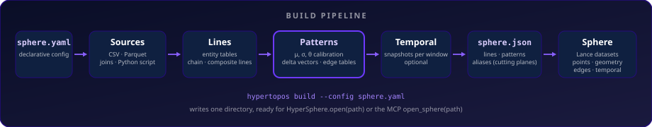
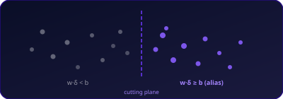

# Configuration — Sphere Builder

> Full YAML reference for building geometric data spheres with the hypertopos CLI.



Build a navigable GDS sphere from your data using a declarative YAML configuration file.

```bash
pip install hypertopos
hypertopos build --config sphere.yaml --output my_sphere/
```

---

## CLI Commands

### `hypertopos build`

Build a sphere from a YAML config file.

```bash
hypertopos build --config sphere.yaml [--output DIR] [--force] [--verbose]
```

| Flag | Description |
|------|-------------|
| `--config` | Path to `sphere.yaml` (required) |
| `--output` | Output directory. Default: `gds_{sphere_id}/` next to the YAML file |
| `--force` | Overwrite output directory if it exists |
| `--verbose` | Print progress with per-phase timing (sources, chains, geometry, temporal) |
| `--no-chains` | Skip chain extraction |
| `--no-temporal` | Skip temporal snapshot generation |
| `--no-edges` | Skip edge table emission |

### `hypertopos validate`

Dry-run: parse and validate YAML without building.

```bash
hypertopos validate --config sphere.yaml
```

Checks:
- Required fields and valid enum values
- Source file/script existence, join file existence
- Line→source, pattern→entity_line, relation→line, composite/chain→event_line cross-references
- graph_features.event_line exists in lines
- Feature metric syntax (`count`, `sum:col`, `count:window=1d:agg=max`)
- event_dimensions only on event-type patterns
- temporal.pattern must be anchor type
- Duplicate dimension names within a pattern
- Cycle detection in from_pattern references

### `hypertopos info`

Print summary of a built sphere: each line's role, row count and column
count, and each pattern's type, entity line and dimension count.

```bash
hypertopos info my_sphere/
```

### `hypertopos sphere` — cloud-ops verbs

Cloud-ops checks over a **built** sphere directory (the one `info` reads),
shaped for CI gates and pre-deploy pipelines. Each verb supports `--json`
for machine-readable output; in JSON mode stdout carries only the JSON
document (diagnostics and errors go to stderr).

#### `hypertopos sphere health`

```bash
hypertopos sphere health my_sphere/ [--json] [--exit-code-on-critical]
```

Composes the population summary (per-pattern entity count, anomaly rate,
calibration health) with the geometric health checks. The derived `status`
is `critical` when any HIGH-severity alert is present, `warning` for
MEDIUM-only, else `ok`. With `--exit-code-on-critical` the process exits `2`
on a critical status (and `0` otherwise) so a `set -e` shell gate can fail a
deploy. JSON payload: `{status, sphere_path, overview, alerts}`.

#### `hypertopos sphere validate`

```bash
hypertopos sphere validate my_sphere/ [--strict] [--json]
```

Structural integrity check over a built sphere: `sphere.json` parses, each
materialized line has a `points/` directory, each pattern has a `geometry/`
directory. `--strict` additionally promotes calibration-health (`suspect` /
`poor`) and dimension-quality warnings to errors. Exits `0` when valid, `1`
when invalid. JSON payload: `{valid, strict, errors, warnings}`.

> This validates a **built** sphere on disk; `hypertopos validate --config`
> validates a `sphere.yaml` before building. They are distinct commands.

#### `hypertopos sphere diff`

```bash
hypertopos sphere diff old_sphere/ new_sphere/ [--json]
```

Pre-deploy diff between two built spheres: pattern-inventory delta (`added` /
`removed` / `common` pattern ids) and per-shared-pattern calibration drift
(`overall_drift_rms` plus the top-drifted dimensions, comparing each sphere's
latest calibration epoch). Patterns whose calibration schema differs between
the two spheres are marked `not_comparable` rather than crashing. Identical
paths yield `identical: true`.

#### `hypertopos sphere ingest`

```bash
hypertopos sphere ingest my_sphere/ --points changed.arrow \
  [--pattern ID] [--recalibrate {auto,force,never}] \
  [--reindex] [--finalize] [--branch NAME] [--json]
```

`--branch NAME` ingests into that sphere branch only; main is not touched and
the reported geometry versions are the branch's.

#### `hypertopos sphere branch`

```bash
hypertopos sphere branch {list,create,delete,promote} my_sphere/ [NAME] \
  [--purpose TEXT] [--json]
```

Lists, creates, deletes or promotes sphere branches. `promote` replays the
branch's recipes on main, requires the replayed result to match the branch
exactly, and deletes the branch on success; it exits 1 when main moved since
the branch was created or the replay diverged (main is restored).

Incrementally appends a new-/changed-entities table to one pattern's geometry
without a full rebuild. The points table may be Arrow IPC (`.arrow` /
`.arrows`), Parquet (`.parquet` / `.pq`), or CSV (`.csv` / `.csv.gz`) and must
carry a `primary_key` column plus the columns the pattern's dimensions
reconstruct from (relations, event dimensions, edge-dim aggregations, or
property columns). `--pattern` is optional when the sphere has a single
pattern and required otherwise. `--reindex` forces an ANN index rebuild so the
appended rows are immediately searchable; `--finalize` recomputes the global
`score_rank_pct` and rebuilds the ANN index once at the end of a batched
ingest session. JSON payload: `{pattern_id, added, modified, deleted,
population_size, drift_pct, geometry_version_before, geometry_version_after,
reindexed, finalized}`. Patterns carrying generalized dimension blocks (geo /
metric / semantic) cannot be reconstructed incrementally and exit 1 with a
clear message directing you to a full rebuild.

---

## YAML Reference — `sphere.yaml`

### Top-level fields

```yaml
version: "0.1.0"              # Required. YAML schema version.

sphere_id: my_sphere          # Required. Unique identifier.
name: "My Sphere"             # Optional. Human-readable name.
description: "What this sphere represents."  # Optional. Stored in sphere.json.

sources: { ... }              # Required. Data source definitions.
lines: { ... }                # Required. Entity line definitions.
patterns: { ... }             # Required. Pattern (anomaly model) definitions.
composite_lines: { ... }      # Optional. Composite anchor lines from event co-occurrence.
temporal: [ ... ]              # Optional. Temporal snapshot configurations.
```

A key the parser does not recognise, at the top level or inside any section below, is ignored with a warning that names it and, for a likely typo, the field it was probably meant to be: `'tiemstamp_col' (did you mean 'timestamp_col'?)`.

---

## Sources

Sources define where your data comes from. Each source produces a single Arrow table.

### Tier 1: Single file (zero Python)

```yaml
sources:
  customers:
    path: data/customers.parquet       # .parquet, .csv, or .arrow
```

Supported formats (auto-detected from extension):
- `.parquet` — Apache Parquet
- `.csv` — CSV (comma-delimited by default)
- `.arrow` — Arrow IPC

### Tier 1b: CSV with options

```yaml
sources:
  transactions:
    path: data/transactions.csv
    format: csv                        # explicit format override
    delimiter: ";"                     # default: ","
    encoding: utf-8                    # default: utf-8
```

### Tier 1c: Column transforms

Apply type casting and null filling without writing Python.

```yaml
sources:
  transactions:
    path: data/transactions.csv
    delimiter: ";"
    transform:
      amount:
        type: float64                  # cast to type
      balance:
        type: float64
        fill_null: 0.0                 # replace nulls
      bank:
        fill_null: ""                  # empty string for missing
      account_id:
        type: string                   # force string even if inferred as int
```

**Supported cast types:** `string`, `int32`, `int64`, `float32`, `float64`, `bool`

Transforms apply **after** joins (if both `join` and `transform` are present).

### Tier 2: Multi-file join

Join multiple files into a single table. No Python required.

```yaml
sources:
  accounts:
    path: data/account.parquet         # base table
    join:
      - file: data/loan.parquet        # join target
        on: account_id                 # join key (same column name on both sides)
        type: left                     # left (default) or inner
        columns: [loan_amount, status] # optional: only pull these columns
      - file: data/card.parquet
        on: account_id
        type: left
        columns: [card_type]
    transform:                         # transforms apply AFTER joins
      loan_amount:
        type: float64
        fill_null: 0.0
```

**Join types:**
- `left` — keep all rows from base table, null for unmatched
- `inner` — keep only matched rows

**`on` field:** Column name used as join key. Must exist on both the base table and the join
file. For joins where the column names differ, rename in a Tier 3 script.

**YAML gotcha:** The `on:` key in YAML 1.1 can be parsed as boolean `True` instead of string
`"on"`. The parser handles both cases — no action needed from the user.

### Tier 3: Python script

For complex transformations (date parsing, computed columns, multi-table assembly).

```yaml
sources:
  accounts:
    script: prepare_accounts.py        # relative to sphere.yaml location
```

**Contract:** The script must define a `prepare()` function that returns a `pyarrow.Table`:

```python
import pyarrow as pa

def prepare() -> pa.Table:
    # Load, join, transform — full Python control
    ...
    return pa.table({
        "primary_key": pa.array([...], type=pa.string()),
        "name": pa.array([...], type=pa.string()),
        "amount": pa.array([...], type=pa.float64()),
    })
```

The `primary_key` column (string) is required on the returned table, or specify a different
key column in the `lines` section.

**When to use Tier 3:**
- Date parsing from non-standard formats (e.g. `YYMMDD` integers)
- Computed columns (e.g. `late_days = max(0, (receipt_date - commit_date).days)`)
- Complex multi-table joins with aggregations
- NaN/sentinel value coercion
- Anomaly injection for benchmarks

---

## Lines

Lines define entity tables in the sphere. Each line maps to one source.

```yaml
lines:
  transactions:
    source: transactions               # Required. References a source name.
    key: trans_id                       # Required. Primary key column.
    role: event                         # Required. "anchor", "event", or "context".

  customers:
    source: customers
    key: customer_id
    role: anchor
    fts: true                          # Enable full-text search index.
    partition_col: region              # Optional. Hive partitioning column.
```

### Field reference

| Field | Type | Default | Description |
|-------|------|---------|-------------|
| `source` | string | — | **Required.** Name of a source defined in `sources:`. |
| `key` | string | — | **Required.** Column to use as `primary_key`. Renamed automatically. |
| `role` | string | `"anchor"` | `"anchor"` (entity), `"event"` (transaction/fact), or `"context"` *(concept — accepted by parser but no special behavior yet)*. |
| `fts` | bool or list | `null` | Full-text search index. `true` = all string columns. `["name", "desc"]` = specific columns. `false`/`null` = none. Default: all for anchor, none for event. |
| `partition_col` | string | `null` | Column for Hive-style partitioning on large lines. |
| `description` | string | `null` | Human-readable description. Stored in sphere.json — visible to agents via `get_sphere_info`. |
| `columns` | dict | `null` | Column rename map: `{new_name: source_col_name}`. Only listed columns are kept. |

### Column selection and rename

```yaml
lines:
  transactions:
    source: raw_transactions
    key: id
    role: event
    columns:
      account_id: acct_num             # rename acct_num → account_id
      amount: tx_amount                # rename tx_amount → amount
      date: transaction_date
```

When `columns` is set, only the listed columns (plus `key`) are included. Unlisted columns
are dropped.

### NB-Split (Narrow-Budget Split)

Multiple lines can reference the same source with different line IDs to isolate
dimensions per concern — preventing dimensional dilution when patterns share an
entity line. This technique is called **NB-Split**. See the `gds-sphere-designer`
skill for design guidelines, benchmark results, and worked examples.

**Cross-line bridging:** Lines sharing the same `source` (same source name in YAML)
are automatically recognized as **sibling lines** at runtime. `composite_risk` and
`passive_scan` bridge across sibling lines — combining p-values via the Wilson
harmonic-mean p-value (HMP), robust under positive dependence between sibling
patterns — even though each pattern operates on its own entity line. This preserves
dimensional isolation while enabling multi-pattern composite scoring.

```yaml
lines:
  accounts:
    source: accounts              # ← same source
    key: primary_key
    role: anchor
  accounts_stress:
    source: accounts              # ← same source = sibling of accounts
    key: primary_key
    role: anchor
```

The `source` field is persisted as `source_id` in sphere.json. It is used solely for
sibling line discovery — no other runtime behavior depends on it.

---

## Patterns

Patterns define anomaly detection models. Each pattern operates on one entity line.

### Event pattern

Detects anomalies in individual events (transactions, line items).

```yaml
patterns:
  tx_pattern:
    type: event
    entity_line: transactions          # Must reference a line with role: event.
    relations:
      - line: customers                # FK target line.
        direction: in                  # "in" = FK points from event to anchor.
        key_on_entity: customer_id     # FK column on the event entity line.
        required: true                 # true = every event must have this edge.
      - line: categories
        direction: in
        key_on_entity: category
        required: false                # false = edge is optional (missing = structural signal).
        display_name: category         # Human-readable dimension label.
    event_dimensions:
      - column: amount                 # Numeric column → continuous geometry dimension.
        display_name: amount
      - column: balance
    edge_dimensions:                    # Optional. Build-time per-edge dims for event patterns.
      - pair_edge_count                 #   Bare name → defaults.
      - position_in_chain:              #   Single-key dict → overrides.
          min_position: 5
      - time_since_pair_last_edge
      - pair_amount_zscore              #   LOW_VAR pairs only.
      - find_motif_structuring
      - edge_curvature_frc              #   Forman-Ricci curvature; no params.
    anomaly_percentile: 95             # Theta threshold percentile (default: 95).
    dimension_weights: kurtosis        # "kurtosis" (recommended), "auto", or [0.5, 0.3, ...].
```

The six available `edge_dimensions` functions: `pair_edge_count` (Poisson, count of edges between this pair), `position_in_chain` (Poisson, ordinal position in detected chain — `min_position` rejects below 3 at YAML parse), `time_since_pair_last_edge` (Gaussian, seconds since this `(from, to)` pair last had an edge), `pair_amount_zscore` (Gaussian, per-pair amount z-score on LOW_VAR pairs only), `find_motif_structuring` (Bernoulli, 1 if this edge participates in any structuring motif), `edge_curvature_frc` (Gaussian, combinatorial Forman-Ricci curvature of the underlying undirected transaction graph: `4 − deg(u) − deg(v) + #triangles(u, v)` — negative values mark sparse-hub topology, near-zero marks tight rings, positive marks over-clustered local structure; no params). Values are baked into the event polygon shape via `dimension_kinds` and written as a sidecar Lance dataset at `_gds_meta/edge_features/{pid}/data.lance` for runtime per-edge predicate filtering.

### Anchor pattern

Detects anomalies in entity populations (customers, accounts, suppliers).

```yaml
patterns:
  customer_pattern:
    type: anchor
    entity_line: customers             # Must reference a line with role: anchor.
    derived_dimensions:
      - from_pattern: tx_pattern       # Derive features from this event pattern (or line).
        features:
          - tx_count: count
          - total_spend: sum:amount
          - avg_amount: avg:amount
          - amount_std: std:amount
          - max_amount: max:amount
          - n_categories: count_distinct:category
          - burst_daily: "count:window=1d:agg=max"
          - burst_monthly: "count:window=30d:agg=max"
    relations: auto                    # Auto-generate _d_* lines from derived dims.
    anomaly_percentile: 95
    dimension_weights: kurtosis
    gmm_n_components: 3               # Gaussian mixture components for calibration.
    group_by_property: segment         # Per-group mu/sigma/theta calibration.
    score_per_group: true              # Score each group against its own calibrated reference.
    tracked_properties: [segment, region]  # Property completeness dimensions.
```

### Pattern field reference

| Field | Type | Default | Description |
|-------|------|---------|-------------|
| `type` | string | — | **Required.** `"event"` or `"anchor"`. |
| `entity_line` | string | — | **Required.** Line ID this pattern operates on. |
| `relations` | list or `"auto"` | `null` | Explicit relation list, or `"auto"` for derived-dim patterns. |
| `event_dimensions` | list | `null` | Numeric columns for continuous event geometry (event patterns only). |
| `derived_dimensions` | list | `null` | Aggregated features from event data (anchor patterns only). |
| `anomaly_percentile` | float | `95.0` | Sets the alarm budget `1 − anomaly_percentile/100`. On a pattern with the calibrated score an entity is anomalous when its `conformal_p` is at most the budget; on other patterns, when `delta_norm` is above theta at this percentile. |
| `score_axes` | list | `[mahal, current]` | Axes of the calibrated evidence score for continuous anchor patterns whose dimensions are point properties. A subset of `mahal` (shrunk-covariance Mahalanobis on rank-Gaussian coordinates), `current` (motion against the population's velocity field, from the pattern's event line) and `knn` (distance to nearest peers; opt-in, adds a nearest-neighbour pass to the build). Must contain `mahal`. `current` is fitted when exactly one event pattern references the pattern's entity line and carries an edge table (from / to keys, timestamp, amount) whose events span more than one moment; otherwise the pattern scores without it. The fitted axes are listed in `score_axes` in sphere.json. |
| `dimension_weights` | string or list | `null` | `"kurtosis"` (recommended), `"auto"`, or explicit weight list. |
| `gmm_n_components` | int | `null` | Gaussian mixture components for multi-modal calibration. `recalibrate` and `incremental_update` refuse such a pattern; rebuild it instead. |
| `group_by_property` | string | `null` | Column for per-group calibration (e.g. per-country theta). |
| `score_per_group` | bool | `false` | When `true`, each group identified by `group_by_property` is scored against its own calibrated reference: `anomaly_score`, `conformal_p`, `score_rank_pct` and `is_anomaly` are within-group. Groups below the minimum reference size are pooled; the geometry column `score_group` names the reference used. Requires `group_by_property`. `recalibrate` refits every group's reference with the same pooling. |
| `tracked_properties` | list | `null` | Entity properties tracked as fill/no-fill dimensions. |
| `use_mahalanobis` | — | — | Removed: the key is rejected at config load. The calibrated score already accounts for correlated dimensions (`mahal` axis), and the stored `delta` stays a per-dimension z-score. |
| `precomputed_dimensions` | list | `null` | Columns already on entity table to use as geometry dimensions. |
| `graph_features` | dict | `null` | Auto-compute graph structural features from event from/to columns. |
| `description` | string | `null` | Human-readable description. Stored in sphere.json — visible to agents via `get_sphere_info`. |
| `edge_table` | dict | `null` | Explicit edge table config (see below). Auto-emitted for event patterns with 2+ FK relations to same anchor line. |
| `edge_dimensions` | list | `null` | Build-time per-edge dims for event patterns. Each item is either a bare dim name or a single-key dict with overrides. Six dims available: `pair_edge_count`, `position_in_chain` (`min_position` ≥ 3, default 5), `time_since_pair_last_edge`, `pair_amount_zscore` (LOW_VAR pairs only), `find_motif_structuring`, `edge_curvature_frc` (Forman-Ricci curvature; no params). |
| `edge_dim_aggregations` | dict | `null` | **Anchor patterns only.** Aggregate per-edge sidecar dims of an event pattern up to per-anchor `_mean` / `_max` columns baked into the anchor polygon. `from: <event_pid>` is required and must reference an event pattern that declares `edge_dimensions:`. `dims: [...]` is required — must be a non-empty list of source dim names from the referenced sidecar (the previous "omit `dims` to aggregate everything" shorthand was removed; explicit declaration prevents build-vs-runtime label drift). Anchor regimes: `single` (account-style, anchor PK matches edge `from_key` OR `to_key`) and `pair` (composite-key, anchor PK = `<from>__<to>`); `chain` raises `NotImplementedError`. Builder switches to a two-phase build (events first, anchors second) when this block is present. |
| `conformance_rules` | list | `null` | Declarative compliance predicates evaluated at build time against the entity-line points table. Each entry has shape `{rule_id?, severity, description?, violates_when}` where `severity` is one of `low` / `medium` / `high` / `critical` and `violates_when` is a predicate AST. `rule_id` is auto-assigned as `r0`, `r1`, ... when omitted; duplicate `rule_id`s are rejected. Predicate ops: `and`, `or`, `not` (logical compounds carry `terms`), `==`, `!=`, `<`, `<=`, `>`, `>=` (carry `prop` + scalar `value`), and `in` (carries `prop` + list `value`). The `prop` field references a raw column on the entity-line points table — unknown columns fail the build immediately. Violators land in a sidecar Lance dataset read by `find_conformance_violations`. |
| `bootstrap_iterations` | int | `200` | Number of bootstrap resamples used to compute `anomaly_confidence` per entity. Skipped automatically for N > 50K, `group_by_property`, and on patterns with the calibrated score. |

### Edge Table

An edge table is a flat Lance dataset linking anchor entities through an event pattern. It enables runtime graph traversal (`find_geometric_path`, `extract_chains`) without pre-computed chain extraction.

**Auto-detection:** When an event pattern has 2+ relations pointing to the same anchor line (e.g. `from_entity` and `to_entity` both referencing the same anchor line), the builder emits an edge table automatically. No YAML config needed.

When auto-detecting, the builder also scans the event line schema for a timestamp column (first match of `timestamp`, `ts`, `event_time`, `created_at`, `tx_date`, `date`) and an amount column (first match of `amount_received`, `amount`, `amount_paid`, `value`, `total`, `amt`). If your columns use different names, declare them explicitly via `edge_table` config below.

**Explicit config:** Use `edge_table` when column names need to be specified manually or when auto-detection does not apply.

```yaml
patterns:
  tx_pattern:
    type: event
    entity_line: transactions
    edge_table:
      from_col: from_account       # Required. Source anchor FK column.
      to_col: to_account           # Required. Target anchor FK column.
      timestamp_col: date          # Optional. Epoch seconds for temporal BFS.
      amount_col: amount           # Optional. Numeric value carried on edges.
    # ... relations, event_dimensions, etc.
```

| Field | Type | Default | Description |
|-------|------|---------|-------------|
| `from_col` | string | — | **Required.** FK column for source anchor entity. |
| `to_col` | string | — | **Required.** FK column for target anchor entity. |
| `timestamp_col` | string | `null` | Timestamp column (epoch seconds). Enables temporal ordering of hops in `extract_chains`. |
| `amount_col` | string | `null` | Numeric column carried on edges. Enables amount-weighted scoring in `find_geometric_path`. |

To skip edge table emission entirely (e.g. for faster iterative builds), use the `--no-edges` CLI flag.

### Generalized Dimension Blocks

Patterns optionally accept three additional dimension block fields that inject geographic, metric, or semantic columns from the entity line into the delta vector. All three are optional — existing configs are unaffected.

```yaml
patterns:
  account_pattern:
    type: anchor
    entity_line: accounts
    # ... existing fields (derived_dimensions, relations, etc.) ...

    # Generalized dimension blocks (optional)
    geo_properties:          # list of geographic column names from entity line
      - latitude
      - longitude
    metric_properties:       # list of numeric column names from entity line
      - balance
      - credit_limit
    semantic_dim:            # embedding dimensionality reduction
      columns:
        - description_embedding
      n_components: 8        # target PCA dimensions
```

| Field | Type | Default | Description |
|-------|------|---------|-------------|
| `geo_properties` | list | `null` | Geographic columns. Normalized with empirical mu/sigma. Dimensions prefixed `g:` (e.g. `g:lat`). |
| `metric_properties` | list | `null` | Numeric columns. Normalized with empirical mu/sigma. Dimensions prefixed `t:` (e.g. `t:balance`). |
| `semantic_dim` | dict | `null` | Embedding columns reduced via SVD-based PCA. Dimensions prefixed `s:` (e.g. `s:pc0`). |
| `semantic_dim.columns` | list | — | **Required** (within `semantic_dim`). List of embedding column names. |
| `semantic_dim.n_components` | int | — | **Required** (within `semantic_dim`). Target number of PCA dimensions. |

Dimension prefixes (`g:`, `t:`, `s:`) appear in `explain_anomaly` output, making it clear which block a dimension belongs to.

### Conformance Rules

Patterns optionally accept a `conformance_rules:` block that declares compliance predicates evaluated at build time against the entity-line points table. Violators land in a sidecar Lance dataset surfaced by the `find_conformance_violations` navigator primitive and MCP tool.

```yaml
patterns:
  account_pattern:
    type: anchor
    entity_line: accounts
    relations: []
    conformance_rules:
      - rule_id: high_amount
        severity: high
        description: account average above compliance ceiling
        violates_when:
          op: ">"
          prop: avg_amount             # Column on the entity-line points table.
          value: 10000

      - rule_id: sanctioned_region
        severity: critical
        violates_when:
          op: in
          prop: country
          value: [XX, ZZ]

      - rule_id: high_value_and_sanctioned
        severity: critical
        violates_when:
          op: and
          terms:
            - op: ">"
              prop: avg_amount
              value: 10000
            - op: in
              prop: country
              value: [XX, ZZ]
```

Predicate language:

| Op | Shape | Description |
|----|-------|-------------|
| `and`, `or` | `{op, terms: [...]}` | Logical compound — non-empty list of child predicates. |
| `not` | `{op, terms: [child]}` | Logical negation — exactly one child predicate. |
| `==`, `!=`, `<`, `<=`, `>`, `>=` | `{op, prop, value}` | Comparison on a single column against a scalar literal. |
| `in` | `{op, prop, value: [...]}` | Membership in a list literal. |

Rules:

- `severity` is one of `low`, `medium`, `high`, `critical`.
- `rule_id` is optional; when omitted, rules are auto-assigned `r0`, `r1`, ... in YAML order. Duplicate `rule_id`s within a pattern are rejected at parse time.
- `description` is optional and surfaced in violation responses for audit context.
- `prop` references a raw column on the entity-line points table — not a dim label. An unknown column fails the build immediately.

### Multiple patterns on the same entity line

You can define multiple patterns for the same anchor line with different calibration:

```yaml
patterns:
  customer_pattern:
    type: anchor
    entity_line: customers
    group_by_property: segment
    gmm_n_components: 3
    tracked_properties: [segment, region]
    # ... same derived_dimensions ...

  customer_risk_pattern:
    type: anchor
    entity_line: customers
    group_by_property: region
    gmm_n_components: 2
    tracked_properties: [region, segment]
    # ... same derived_dimensions ...
```

Both patterns share the same derived dimensions (registered once, deduplicated automatically).
Different `group_by_property` and `tracked_properties` produce independent calibrations.
Use `composite_risk` in the MCP layer to combine signals via the Wilson harmonic-mean
p-value (HMP), robust under positive dependence between patterns sharing derived
dimensions.

### Relation fields

| Field | Type | Default | Description |
|-------|------|---------|-------------|
| `line` | string | — | **Required.** Target anchor line ID. |
| `direction` | string | `"in"` | `"in"` (FK points from event to anchor) or `"out"`. |
| `key_on_entity` | string | `null` | FK column name on the entity line. Auto-resolved if null. |
| `required` | bool | `true` | Whether every entity must have this edge. |
| `display_name` | string | `null` | Name of the relation (e.g. `sender`, `receiver`). Selects it in `aggregate(group_by_relation=...)` and is accepted wherever a dimension name is taken. It becomes the dimension label only when the pattern has several relations to the same line; otherwise the label is the line ID (rename labels with `semantics.json`). |
| `edge_max` | int | `null` | Continuous mode cap: `null` = binary (0/1), integer = count capped at this value. |

### Event dimension fields

| Field | Type | Default | Description |
|-------|------|---------|-------------|
| `column` | string | — | **Required.** Numeric column on the event entity line. |
| `display_name` | string | `null` | Human-readable label. Defaults to column name. |

### Derived dimension feature syntax

Features are specified as `dimension_name: metric_spec`:

| Syntax | Metric | Example |
|--------|--------|---------|
| `name: count` | Row count per anchor entity | `tx_count: count` |
| `name: sum:col` | Sum of column | `total_spend: sum:amount` |
| `name: avg:col` | Mean of column | `avg_amount: avg:amount` |
| `name: std:col` | Population standard deviation (exactly 0 for a group of identical values) | `amount_std: std:amount` |
| `name: max:col` | Maximum value | `max_amount: max:amount` |
| `name: count_distinct:col` | Distinct value count | `n_cats: count_distinct:category` |
| `name: "count:window=Xd:agg=Y"` | Windowed count (burst) | `burst_daily: "count:window=1d:agg=max"` |
| `name: "sum:col:window=Xd:agg=Y"` | Windowed sum | `spend_monthly: "sum:amount:window=30d:agg=max"` |

**Window parameters:**
- `window=Xd` — rolling window size (`1d`, `7d`, `30d`, `90d`, etc.)
- `agg=Y` — aggregation over windows: `max` (peak), `mean`, `min`

**Temporal windowing requires:** a `temporal` config for the pattern (provides `timestamp_col`).

**`from_pattern` resolution:** Can reference a pattern ID (resolves to its entity_line) or
a line ID directly. When referencing a pattern, the FK column is auto-resolved from the
pattern's relations. When referencing a line, the FK is inferred from naming convention
(`{anchor_line}_id` → strips trailing 's').

**`anchor_fk` override:** When an event pattern has multiple relations to the same anchor line
(e.g. two FK columns both pointing to the same anchor line), the auto-resolve picks
the first match. Use `anchor_fk` to disambiguate:

```yaml
derived_dimensions:
  # Outgoing: auto-resolves to first FK (from_account)
  - from_pattern: tx_pattern
    features:
      - tx_out_count: count
  # Incoming: explicit FK override
  - from_pattern: transactions
    anchor_fk: to_account
    features:
      - tx_in_count: count
```

**IET (inter-event-time) metrics:**

```yaml
- from_pattern: tx_pattern
  features:
    - avg_gap_between_tx: iet_mean    # mean gap (seconds) between events per entity
    - tx_regularity: iet_std          # std of gaps — low = regular, high = bursty
    - fastest_gap: iet_min            # minimum gap — shortest interval between consecutive events
```

IET requires a `temporal` config for the pattern (provides `timestamp_col`).
Temporal column is auto-resolved from the temporal config — no explicit time_col needed.

**Dimension `kind` on derived dimensions:** Each derived feature can carry an explicit `kind` tag to override auto-detection. Add it as an extra property alongside the feature spec:

```yaml
derived_dimensions:
  - from_pattern: tx_pattern
    features:
      - tx_count: count
        kind: poisson           # override auto-detection
      - total_spend: sum:amount
        kind: gaussian
      - has_foreign: count_distinct:country
        kind: bernoulli         # treat as 0/1 presence indicator
```

When omitted, `kind` is auto-detected from the metric type — see below.

---

### Dimension Kind Auto-Detection

The builder assigns a `kind` tag to every dimension at build time. The tag drives Bregman divergence scoring: each dimension contributes an anomaly score calibrated to its own distribution family rather than a single global metric.

**Auto-detection rules:**

| Dimension source | Inferred kind | Rationale |
|-----------------|---------------|-----------|
| Binary FK (`edge_max = null`) | `bernoulli` | 0/1 presence indicator |
| `count`, `count_distinct`, `count:window=*` | `poisson` | Event counts follow Poisson arrival models |
| `sum:col`, `avg:col`, `std:col`, `iet_*` | `gaussian` | Continuous magnitudes |
| `max:col`, `min:col` | `gaussian` | Extremal statistics |
| `precomputed_dimension` with `edge_max: 1` | `bernoulli` | Binary column indicator |
| `precomputed_dimension`, otherwise | `gaussian` | Default continuous |
| `graph_features` (`in_degree`, `out_degree`) | `poisson` | Degree counts (`edge_max > 1`) |
| `graph_features` (`reciprocity`, `counterpart_overlap`) | `bernoulli` | Binary presence (`edge_max = 1`) |
| `graph_features` (`pagerank`, `betweenness`, `clustering_coefficient`) | auto | Continuous scores (igraph C backend) |
| `graph_features` (`community`, `connected_component`) | auto | Integer IDs (categorical) |
| `geo_properties`, `metric_properties` | `gaussian` | Continuous measurements |

**Override via `kind:`** on precomputed dimension entries (`gaussian`, `poisson` or `bernoulli`). The override takes precedence over auto-detection; an unknown value fails the config. Derived and event dimensions use auto-detection only.

---

## Composite Lines

Composite lines create implicit anchor entities from event data co-occurrence (e.g.
customer×merchant pairs, supplier×part pairs).

```yaml
composite_lines:
  customer_merchant_pairs:
    event_line: transactions           # Source event line.
    key_cols: [customer_id, merchant_id]  # Columns forming the composite key.
    separator: "|"                     # Key separator (default: "|").
    derived_dimensions:
      - features:
          - pair_tx_count: count
          - pair_total: sum:amount
          - pair_std: std:amount
          - pair_diversity: count_distinct:category
    anomaly_percentile: 95
    dimension_weights: kurtosis
```

A composite line automatically:
1. Creates an anchor line with composite primary keys (e.g. `"CUST-001|MERCH-042"`)
2. Registers an anchor pattern (`{line_id}_pattern`)
3. Computes derived dimensions from the event data

### Composite line field reference

| Field | Type | Default | Description |
|-------|------|---------|-------------|
| `event_line` | string | — | **Required.** Event line to extract pairs from. |
| `key_cols` | list | — | **Required.** Column names forming the composite key. |
| `separator` | string | `"\|"` | Separator for composite primary key string. |
| `derived_dimensions` | list | `null` | Feature aggregations (same syntax as pattern features). |
| `anomaly_percentile` | float | `95.0` | Theta threshold for the auto-created pattern. |
| `dimension_weights` | string or list | `null` | Weight strategy for the auto-created pattern. |
| `description` | string | `null` | Human-readable description for the composite line and its auto-created pattern. |

---

## Precomputed Dimensions

Use when entity properties are already computed (ratios, scores, flags) and just need
normalization as geometry dimensions.

```yaml
patterns:
  account_pattern:
    precomputed_dimensions:
      - column: intermediary_score       # Column already on entity table.
        edge_max: 1                      # Fixed max (0-1 ratio). Or "auto".
      - column: fan_asymmetry
        edge_max: 1
      - column: structuring_pct
        edge_max: 1
        display_name: structuring        # Optional label.
      - column: n_counterparties
        kind: poisson                    # Optional Bregman kind override.
```

| Field | Type | Default | Description |
|-------|------|---------|-------------|
| `column` | string | — | **Required.** Column name on the entity table. Must already exist. |
| `edge_max` | int or `"auto"` | `"auto"` | Fixed normalization cap, or auto-compute from percentile. |
| `percentile` | float | `99.0` | Percentile for auto edge_max computation. |
| `display_name` | string | `null` | Human-readable dimension label. |
| `kind` | string | auto | Bregman kind: `gaussian`, `poisson` or `bernoulli`. Auto gives `bernoulli` for `edge_max: 1` and `gaussian` otherwise. |

---

## Graph Features

Auto-compute graph structural features from event data with from/to columns.

```yaml
patterns:
  account_pattern:
    graph_features:
      event_line: transactions
      from_col: from_account
      to_col: to_account
      features: [in_degree, out_degree, reciprocity, counterpart_overlap, pagerank, betweenness, community, clustering_coefficient, connected_component]
```

**Supported features:**
- `in_degree` — number of unique incoming edges
- `out_degree` — number of unique outgoing edges
- `reciprocity` — fraction of counterparties with bidirectional flow
- `counterpart_overlap` — Jaccard similarity of in/out counterparty sets
- `pagerank` — network centrality (igraph C backend)
- `betweenness` — bridge score between communities (edge-sampled on large graphs)
- `community` — community ID via label propagation (seeded, so the same data gives the same communities on every build)
- `clustering_coefficient` — local triangle density
- `connected_component` — isolated subgraph membership

| Field | Type | Default | Description |
|-------|------|---------|-------------|
| `event_line` | string | — | **Required.** Event line with from/to columns. |
| `from_col` | string | — | **Required.** Source entity FK column. |
| `to_col` | string | — | **Required.** Destination entity FK column. |
| `features` | list | all nine | Which features to compute. Requires `pip install hypertopos[graph]` for pagerank/betweenness/community/clustering_coefficient/connected_component. |

---

## Chain Lines

Extract multi-hop entity chains via seeded BFS and register as an anchor line.

```yaml
chain_lines:
  tx_chains:
    event_line: transactions
    from_col: from_account
    to_col: to_account
    features:
      - hop_count
      - is_cyclic
      - time_span_hours
      - n_distinct_categories
      - amount_decay
    seed_percentile_fan_out: 95          # Seed entities with fan-out above p95.
    seed_multi_currency: 2               # Seed entities with 2+ categories.
    seed_pass_through: true              # Seed pass-through entities (in>=2, out>=2).
    time_window_hours: 168               # 7-day chain window.
    max_hops: 15
    min_hops: 2
    max_chains: 300000
    bidirectional: true
    anomaly_percentile: 95
    description: "Entity chains — multi-hop paths through the event graph."
```

Automatically creates an anchor line + pattern (`{line_id}_pattern`).

| Field | Type | Default | Description |
|-------|------|---------|-------------|
| `event_line` | string | — | **Required.** Event line whose source table the chains are extracted from. |
| `from_col` | string | — | **Required.** Source entity FK column. Events with a null `from_col` or `to_col` are skipped. |
| `to_col` | string | — | **Required.** Destination entity FK column. |
| `features` | list | 4 default | Chain features to use as geometry dimensions. |
| `seed_percentile_fan_out` | float | `95.0` | Fan-out percentile for seed selection. |
| `seed_percentile_cross_bank` | float | `90.0` | Accepted but not used by seed selection. |
| `seed_multi_currency` | int | `2` | Min distinct categories for seed selection. |
| `seed_pass_through` | bool | `true` | Include pass-through entities as seeds. |
| `time_window_hours` | int | `168` | Max time span for a chain (hours). |
| `max_hops` | int | `15` | Max chain length. |
| `min_hops` | int | `2` | Min chain length. |
| `max_chains` | int | `300000` | Max chains to extract. |
| `bidirectional` | bool | `true` | Follow edges in both directions. The runtime `extract_chains` defaults to `false`, so the two surfaces give different chains for the same events unless this is set explicitly. With `true` a hop may run against the transaction direction, so `is_cyclic`, `amount_decay` and `amount_monotone_decreasing` describe a walk over the transaction graph rather than a flow of funds; set `false` when those features should follow the money. |
| `anomaly_percentile` | float | `95.0` | Theta for the auto-created chain pattern. |
| `description` | string | `null` | Description for chain line + pattern. |
| `timestamp_col` | string | `null` | Event time column of the source table. When omitted: the `timestamp_col` of the event pattern's `edge_table` on this `event_line`, then the first of `timestamp`, `date`, `orderdate`, then the first timestamp-typed column. |
| `amount_col` | string | `null` | Event amount column of the source table. When omitted: the `amount_col` of the event pattern's `edge_table` on this `event_line`, then the first of `amount_received`, `amount`, `extendedprice`, `fare_amount`, `total_amount`. |
| `category_col` | string | `null` | Event category column of the source table (feeds `n_distinct_categories` and the multi-category seed rule). When omitted: the first of `receiving_currency`, `category`, `k_symbol`, `type`. |
| `edge_dim_aggregations` | dict | `null` | Aggregate per-edge sidecar dims of an event pattern up to per-chain aggregated columns baked into the chain anchor polygon. `from: <event_pid>` is required and must reference an event pattern that declares `edge_dimensions:` and whose `edge_table.event_line` matches this `chain_lines.<id>.event_line` (validated at parse time). `dims:` is required and accepts either a list of source dim names (each dim emits all five canonical aggregates: `mean` / `max` / `std` / `p95` / `count_above_threshold`) or a mapping `{dim: [agg, …]}` for an explicit per-dim subset. The chain anchor pattern's polygon shape grows by the total number of selected aggregates; downstream primitives (`find_anomalies`, `explain_anomaly`, `find_clusters`) surface the new dims transparently. |

**Example with edge-dim aggregation on chain anchor (list form — all five aggregates per dim):**

```yaml
chain_lines:
  tx_chains:
    event_line: transactions
    from_col: from_account
    to_col: to_account
    features: [hop_count, is_cyclic, time_span_hours]
    edge_dim_aggregations:
      from: tx_pattern                    # event pattern declaring edge_dimensions
      dims: [find_motif_structuring, position_in_chain]
```

The chain anchor `tx_chains_pattern` then exposes
`find_motif_structuring_mean` / `_max` / `_std` / `_p95` /
`_count_above_threshold` and the same five suffixes for `position_in_chain`
in `find_anomalies` response and `Pattern.dim_labels`.

**Example with per-dim subset (mapping form) — pick only the aggregates you need:**

```yaml
chain_lines:
  tx_chains:
    event_line: transactions
    from_col: from_account
    to_col: to_account
    features: [hop_count]
    edge_dim_aggregations:
      from: tx_pattern
      dims:
        find_motif_structuring: [mean, count_above_threshold]
        position_in_chain: [max]
```

The chain anchor exposes only `find_motif_structuring_mean`,
`find_motif_structuring_count_above_threshold`, and `position_in_chain_max`
— three aggregated columns instead of ten. Reordering the user-supplied
aggregate list does not affect polygon-dim layout (canonical `AGGREGATE_NAMES`
order applies per dim) or `schema_hash`.

---

## Aliases

An alias defines a named sub-population of a pattern using a cutting plane in delta-space.



```yaml
aliases:
  high_value:
    base_pattern: customer_pattern
    cutting_plane:
      dimension: 0          # which delta dimension
      threshold: 2.0        # the bias value (b)
```

### Alias field reference

| Field | Type | Default | Description |
|-------|------|---------|-------------|
| `base_pattern` | string | — | **Required.** Pattern this alias filters. |
| `cutting_plane.dimension` | int | — | **Required.** Delta dimension index for the hyperplane. |
| `cutting_plane.threshold` | float | — | **Required.** Bias value (b) for the cutting plane. |
| `cutting_plane.normal` | list[float] | `null` | Explicit cutting plane normal vector (advanced — overrides dimension/threshold). |
| `cutting_plane.bias` | float | `null` | Explicit bias for custom normal (advanced). |
| `description` | string | `null` | Human-readable description. |

Navigation primitives (π5, π6, etc.) accept an `alias_id` parameter to restrict operations to the alias sub-population.

---

## Temporal

Temporal snapshots track how anchor entity geometry changes over time.

```yaml
temporal:
  - pattern: customer_pattern          # Anchor pattern to snapshot.
    event_line: transactions           # Event line providing timestamps.
    timestamp_col: date                # Date/timestamp column on the event line.
    window: 90d                        # Snapshot window size.

  - pattern: supplier_pattern
    event_line: lineitems
    timestamp_col: orderdate
    window: 90d
```

Each entry generates rolling temporal snapshots and builds a trajectory index for the
anchor pattern. Multiple entries are supported (one per anchor pattern).

After temporal build, the following MCP tools become available:
- `dive_solid` / `get_solid` — entity temporal history
- `find_drifting_entities` — population drift ranking
- `find_drifting_similar` — trajectory ANN search
- `compare_time_windows` — population centroid shift
- `find_regime_changes` — changepoint detection

### Temporal field reference

| Field | Type | Default | Description |
|-------|------|---------|-------------|
| `pattern` | string | — | **Required.** Anchor pattern ID. |
| `event_line` | string | — | **Required.** Event line providing timestamps. |
| `timestamp_col` | string | — | **Required.** Date/timestamp column on the event line. |
| `window` | string | — | **Required.** Rolling window size (e.g. `"90d"`, `"30d"`). |

---

## Complete Examples

### Minimal sphere (2 files, no transforms)

```yaml
sphere_id: simple_sales
name: "Sales Analysis"

sources:
  orders:
    path: data/orders.parquet
  customers:
    path: data/customers.parquet

lines:
  orders:
    source: orders
    key: order_id
    role: event
  customers:
    source: customers
    key: customer_id
    role: anchor
    fts: true

patterns:
  order_pattern:
    type: event
    entity_line: orders
    relations:
      - line: customers
        direction: in
        key_on_entity: customer_id
        required: true
    event_dimensions:
      - column: amount
    anomaly_percentile: 95

  customer_pattern:
    type: anchor
    entity_line: customers
    derived_dimensions:
      - from_pattern: order_pattern
        features:
          - order_count: count
          - total_spend: sum:amount
          - avg_order: avg:amount
    relations: auto
    anomaly_percentile: 95
    dimension_weights: kurtosis
```

```bash
hypertopos build --config sphere.yaml --output gds_sales/
```

### Full sphere (joins, temporal, alias)

```yaml
sphere_id: banking_demo
name: "Banking Analysis"

sources:
  accounts:
    path: data/accounts.parquet
  transactions:
    path: data/transactions.csv
    delimiter: ";"
    transform:
      amount: { type: float64 }
      balance: { type: float64, fill_null: 0.0 }

lines:
  transactions:
    source: transactions
    key: trans_id
    role: event
  accounts:
    source: accounts
    key: account_id
    role: anchor
    fts: true
  districts:
    source: accounts
    key: account_id
    role: anchor
    columns: { district_id: district_id }

patterns:
  tx_pattern:
    type: event
    entity_line: transactions
    relations:
      - line: accounts
        direction: in
        key_on_entity: account_id
    event_dimensions:
      - column: amount
      - column: balance
    anomaly_percentile: 95
    dimension_weights: kurtosis

  account_pattern:
    type: anchor
    entity_line: accounts
    derived_dimensions:
      - from_pattern: tx_pattern
        features:
          - tx_count: count
          - total_amount: sum:amount
          - avg_amount: avg:amount
          - amount_std: std:amount
          - burst_daily: "count:window=1d:agg=max"
    relations: auto
    anomaly_percentile: 95
    dimension_weights: kurtosis

aliases:
  high_value_accounts:
    base_pattern: account_pattern
    cutting_plane:
      dimension: 1
      threshold: 2.5
    description: "Accounts with unusually high total_amount"

temporal:
  - pattern: account_pattern
    event_line: transactions
    timestamp_col: date
    window: 90d
```

---

## Performance

### Caching

The build CLI caches expensive operations automatically. Caches are stored in a `.cache/`
directory next to the `sphere.yaml` file.

| Cache | What | Invalidation |
|-------|------|-------------|
| **Tier 3 script results** | `prepare()` output saved as `.cache/{script}.parquet` | Script file modification time (mtime) changes |

**First build** runs everything from scratch. **Subsequent builds** (with `--force`) skip
Tier 3 scripts if inputs haven't changed. Chain extraction runs on every build.

To force a full rebuild without cache, delete the `.cache/` directory:
```bash
rm -rf .cache/
hypertopos build --config sphere.yaml --force --verbose
```

### Parallelism

The builder parallelizes where possible:
- **Points write** — parallel across lines (ThreadPoolExecutor, up to 4 workers)
- **Pipeline mode** (when `temporal:` is configured) — each pattern runs geometry → temporal as a sequential pipeline, with up to 4 patterns executing concurrently. Temporal for a pattern starts immediately after its geometry completes, without waiting for other patterns.
- **Geometry-only mode** (no `temporal:` or `--no-temporal`) — geometry runs in parallel across patterns (up to 4 threads)
- **Temporal adaptive chunking** — when the shape tensor exceeds available RAM, the temporal phase uses adaptive memory chunking (auto-detected via platform API, 4 GB fallback)

### Build timing

Use `--verbose` to see per-phase timing:
```
Source 'transactions': 5,078,345 rows, 18 cols
Source 'accounts': 515,080 rows, 11 cols
Sources total: 0.6s
Extracting chains for 'tx_chains'...
  Chains extracted: 290,784
Chains total: 9.5s
Building geometry + temporal (pipeline)...
Geometry + temporal total: 304.9s
Build total: 315.5s
```

### Skip flags (iterative build)

```bash
# Step 1: Geometry only — fast iteration on dimensions + calibration
hypertopos build --config sphere.yaml --force --verbose --no-chains --no-temporal --no-edges

# Step 2: Add edges + temporal
hypertopos build --config sphere.yaml --force --verbose --no-chains

# Step 3: Full build with chains
hypertopos build --config sphere.yaml --force --verbose
```

### Example sphere configurations

| Scale | Edge table | Chains | Temporal | Composites | Key features |
|-------|-----------|--------|----------|------------|--------------|
| Small (~thousands of entities) | none | none | 3 patterns (90d) | entity×group pairs | NB-Split (multiple isolated entity lines), precomputed dims, group_by_property |
| Medium (~hundreds of zones, millions of events) | auto-detected | none | 2 patterns (7d) | none | NB-Split (origin + destination lines), 6 event dims, 2 anchor patterns |
| Large (~hundreds of thousands of entities, millions of events) | explicit (from_account → to_account, timestamp, amount) | yes (seeded BFS) | 3 patterns (2d) | entity pairs | graph_features, precomputed ratios, IET metrics |

### Chain extraction

Chain BFS runs in a single process and is deterministic: the same events and chain settings always yield the same chains. A seed never emits the same set of events twice, and a chain whose entity path is a strict prefix of a longer chain is dropped.

---

## Troubleshooting

### "Column validation failed"

The build performs early column validation before heavy work. If a referenced column
doesn't exist in the source data, you'll see a clear error listing all problems:

```
error: build failed: Column validation failed:
  Line 'orders': key column 'order_id' not in source 'raw_orders'
  Pattern 'tx_pattern': event_dimension column 'balance' not in source
  Pattern 'tx_pattern': relation key_on_entity 'cust_id' not in source
```

Check:
- Column name spelling (case-sensitive)
- If using `columns:` rename map, use the NEW name (after rename)
- If source is a Tier 3 script, verify the returned table has the expected columns

### "Source 'X' not found"

A line references a source name not defined in `sources:`. Check spelling.

### CSV type inference issues

PyArrow's CSV reader infers column types, which can fail:
- Integer column with one null → inferred as `double` (not `int64`)
- Date column `20240101` → inferred as `int64` (not date)

Fix: add `transform:` with explicit `type:` casts, or use a Tier 3 script.

### "duplicate vectors" warnings during build

Lance KMeans index warnings are normal for small datasets (<10K entities). The sphere
is fully functional — ANN search falls back to brute-force scan which is fast at this scale.

### Multiple patterns share derived dimensions

When two patterns have the same `entity_line` and the same derived dimensions, the builder
deduplicates automatically. Register derived dims on ONE pattern or BOTH — the result is
identical. Both patterns will share the same `_d_*` dimension lines.

### Output directory already exists

Use `--force` to overwrite, or delete manually before building.
```bash
hypertopos build --config sphere.yaml --force
```

---

## See also

- [Quickstart](quickstart.md) — build your first sphere in 5 minutes
- [Concepts](concepts.md) — Points, Edges, Polygons, Solids, Patterns, Aliases
- [API Reference](api-reference.md) — Python API for HyperSphere, HyperSession, GDSNavigator
- [Data Format](data-format.md) — physical Arrow IPC layout, sphere.json schema
